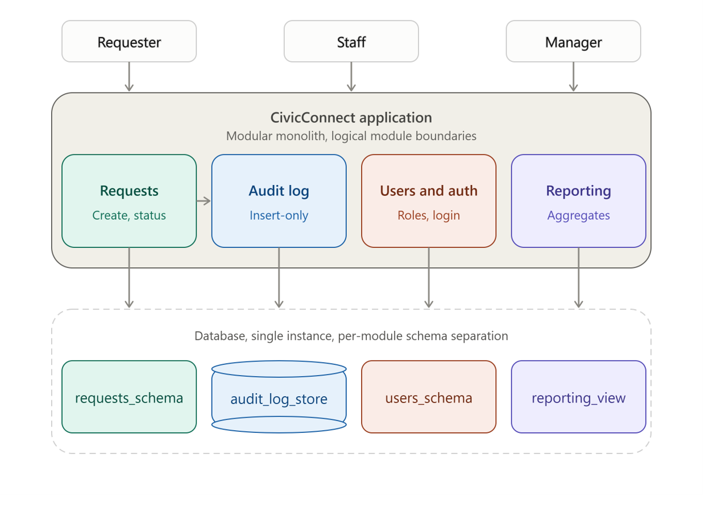
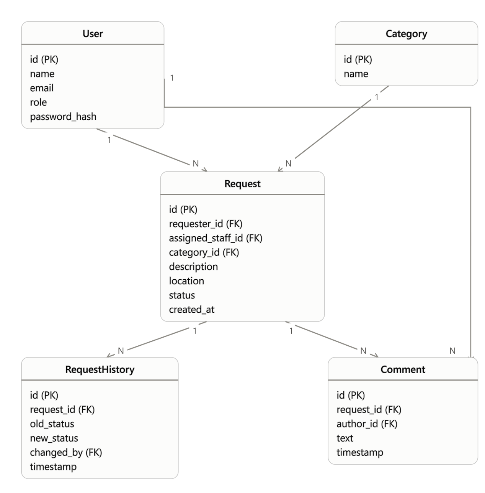

Project Engineering document (PED\_ v3.5)

SEN 381

# Contents

- [Document Control Log](changelog/README.md)
- [Problem Statement & business need](#problem-statement--business-need)
- [Stakeholder analysis](#stakeholder-analysis)
- [Scope baseline](#scope-baseline)
  - [In scope](#in-scope)
    - [Request submission & tracking](#request-submission--tracking)
    - [Staff assignment and status management](#staff-assignment-and-status-management)
    - [Management reporting & oversight](#management-reporting--oversight)
    - [Access control](#access-control)
  - [Out of scope](#out-of-scope)
  - [Deferred / future scope](#deferred--future-scope)
  - [Exclusion defence](#exclusion-defence)
- [Requirements & acceptance criteria](#requirements--acceptance-criteria)
  - [Functional Requirements (FRs)](#functional-requirements-frs)
  - [Non-Functional Requirements (NFRs):](#non-functional-requirements-nfrs)
  - [Acceptance criteria:](#acceptance-criteria)
- [Constraints](#constraints)
  - [Scope constraint](#scope-constraint)
  - [Schedule constraint](#schedule-constraint)
  - [Cost/Resources constraint](#costresources-constraint)
  - [Quality constraint](#quality-constraint)
  - [Security Constraint](#security-constraint)
  - [Trade-off](#trade-off)
- [Requirements Traceability Matrix (RTM)](#requirements-traceability-matrix-rtm)
- [End-to-end traceability](#end-to-end-traceability)
- [Test cases and verification evidence](#test-cases-and-verification-evidence)
- [Risk register](#risk-register)
- [Forward engineering considerations](#forward-engineering-considerations)
- [ASR’s & quality drivers](#asrs--quality-drivers)
  - [NFR-002 (Performance: staff list view response time)](#nfr-002-performance-staff-list-view-response-time)
  - [NFR-003 (Security: data in transit/credentials, nothing sensitive in repo)](#nfr-003-security-data-in-transitcredentials-nothing-sensitive-in-repo)
  - [NFR-005 (Auditability: immutable action log)](#nfr-005-auditability-immutable-action-log)
  - [NFR-007 (Scalability: data model/queries hold up as volume grows)](#nfr-007-scalability-data-modelqueries-hold-up-as-volume-grows)
  - [NFR-008 (Compliance/Data Handling: role-gated sensitive data)](#nfr-008-compliancedata-handling-role-gated-sensitive-data)
- [Architecture diagrams](#architecture-diagrams)
  - [Justifications](#justifications)
    - [Why not a standard monolith](#why-not-a-standard-monolith)
    - [Why not microservices](#why-not-microservices)
    - [Why modular monolith](#why-modular-monolith)
  - [Architecture diagram](#architecture-diagram)
  - [Architecture vs. technology, logical modules vs. physical deployment tiers](#architecture-vs-technology-logical-modules-vs-physical-deployment-tiers)
- [Architecture Decision Record(ADR)](#architecture-decision-recordadr)
  - [Decision ID: ADR-001](#decision-id-adr-001)
  - [Decision ID: ADR-002](#decision-id-adr-002)
  - [Decision Record: ADR-003](#decision-record-adr-003)
  - [Decision Record: ADR-004](#decision-record-adr-004)
  - [Decision Record: ADR-005](#decision-record-adr-005)
  - [Decision Record: ADR-006](#decision-record-adr-006)
- [Technology-Stack Decision](#technology-stack-decision)
  - [Stack Overview](#stack-overview)
  - [Technology Comparison Evidence](#technology-comparison-evidence)
    - [Frontend Selection Evidence](#frontend-selection-evidence)
    - [Backend & Runtime Selection Evidence](#backend--runtime-selection-evidence)
    - [Persistence Engine Selection Evidence](#persistence-engine-selection-evidence)
- [Deployment Compatibility Notes Tied to the Stack](#deployment-compatibility-notes-tied-to-the-stack)
- [Initial Design-Pattern Decisions](#initial-design-pattern-decisions)
  - [Design Decision 1: Request Status State Machine & Workflow Transitions](#design-decision-1-request-status-state-machine--workflow-transitions)
  - [Design Decision 2: Audit Trail Event Dispatching & Notification Triggering](#design-decision-2-audit-trail-event-dispatching--notification-triggering)
- [Initial Module Interface & Integration Decisions](#initial-module-interface--integration-decisions)
- [Data and persistence baseline](#data-and-persistence-baseline)
  - [Data Entities, Relationships and Ownership](#data-entities-relationships-and-ownership)
  - [Foreign key structure](#foreign-key-structure)
  - [Lifecycle implications](#lifecycle-implications)
  - [ERD diagram](#erd-diagram)
  - [Persistence model classification](#persistence-model-classification)
    - [Structure and relationships](#structure-and-relationships)
    - [Access patterns](#access-patterns)
    - [Integrity and consistency](#integrity-and-consistency)
    - [Sensitivity](#sensitivity)
    - [Expected growth](#expected-growth)
    - [Conclusion](#conclusion)
  - [A2-Informed Transaction and Validation Strategy](#a2-informed-transaction-and-validation-strategy)
  - [Database-Level SPOF, Scalability, Availability and Backup/Recovery](#database-level-spof-scalability-availability-and-backuprecovery)
    - [Scalability](#scalability)
    - [Availability](#availability)
    - [Backup/recovery](#backuprecovery)
- [Engineering decision log](#engineering-decision-log)
  - [Decision ID: DEC-001](#decision-id-dec-001)
  - [Decision ID: DEC-002](#decision-id-dec-002)
  - [Decision ID: DEC-003](#decision-id-dec-003)
  - [Decision ID: DEC-004](#decision-id-dec-004)
- [References](#references)
- [AI usage Register](#ai-usage-register)
- [Sign off](#sign-off)

# Problem Statement & business need

The current problem is that various types of service requests are currently handled using different un-optimal methods, this causes many problems, including but not limited to lost or duplicated records. Thus, a significant need for a functioning system exists.

The organisation needs a managed digital platform that provides a reliable, traceable and usable way to submit, manage, monitor and report on various service requests. The solution must increase visibility and accountability whilst maintaining a sustainable technical, operational and financial impact.

# Stakeholder analysis 

From the scenario we can identify 3 stakeholders namely requesters, staff & management.

| Stakeholder | Needs | Influence | Interest | Conflicts |
|---|---|---|---|---|
| Requester | Submit a request easily and get status updates. | Low | High | Frequent updates conflicts with staff’s need to avoid update overhead |
| Staff | Fast acknowledgment, possible escalation path, discretion for sensitive reports,  clear work assignment, | Medium | High | Wants minimal mandatory fields, conflicts with managers need for granular reporting |
| Management | Reliable, auditable, information on work | High | Medium | Wants detailed reporting, conflicts with Staff’s need for lightweight logging |
| Lecturer | Good work that follows the project baseline and relative milestone requirements. | High | High | None at present. |

# Scope baseline

## In scope

### Request submission & tracking 

- Requesters can submit a new service request with category, description, and relevant details

- Requesters can categorise a request using a controlled (fixed) category list

- Requesters can view status of their own submitted requests

- Requesters can view a history/list of their previously submitted requests

- Requesters receive automated notification when a request is accepted, rejected, updated, or completed (in-app/email — not SMS)

### Staff assignment and status management

- Staff can view requests relevant to their authorised role

- Staff can search, filter, and sort requests (by status, category, date, etc.)

- Staff can view full request details

- Staff can assign or accept responsibility for a request

- Staff can update request status through defined, controlled transitions (e.g. New → Assigned → In Progress → Resolved → Closed)

- Staff can record comments/actions/resolution notes against a request

- Staff can resolve or close requests where authorised

### Management reporting & oversight

- Management can view service activity summaries (open/overdue/resolved/closed counts)

- Management can filter/view requests by category, status, and other basic dimensions

- Management has access to enough information to support basic accountability and performance review

### Access control

- Basic role-based access control separating Requester/Staff/Management views

## Out of scope

- SMS/push notifications- excluded on cost grounds. SMS gateway pricing carries per-segment charges plus recurring monthly number-rental fees regardless of volume tier (Twilio, 2026), making it an ongoing operational cost incompatible with the project's free/low-cost constraint.

- Native mobile application- excluded on schedule and team-capability grounds. Native development typically costs two to four times more than an equivalent web product and requires separate platform-specific codebases, increasing both build time and team learning curve beyond what the milestone schedule allows (MayaLogic, 2026).

- Multi-language support- excluded on schedule grounds

- Advanced analytics/BI dashboards — excluded as beyond core business need for this project.

## Deferred / future scope

- SLA-based auto-escalation of overdue requests

- Integration with external helpdesk systems

- Fine-grained, configurable category management

## Exclusion defence

SMS notifications were excluded because they require a paid gateway service to run, this directly conflicts with the constraint that free tools must be used to create the system. An in-app and email notification must satisfy the same underlying requester need “I know my request was not lost”, without introducing a recurring cost or an external service dependency.

# Requirements & acceptance criteria

## Functional Requirements (FRs)

Each FR below maps to exactly one of the three capability groups in the SEN381 Master Brief document under section 3 namely Requester, Staff and Management and a cross-cutting access control requirement. This access control requirement exists because sections 4 and 16 of the same master brief document treats security as a lifecycle-wide constraint and not just as an afterthought and because a request-management platform handling potentially sensitive information cannot be meaningfully evaluated without knowing who is allowed to view or act on each FR below.

The question, “Does the platform lose its core value proposition without this?” was used to determine priorities. It is necessary for a requester, staff or manager to have everything they need to finish the basic request lifecycle namely submit --\> assign --\> action --\> resolve --\> report. Filtering, overdue flagging and grouping are examples of convenience features that enhance the experience but are not essential. The team could still present a functional platform without these, but they provide significant stakeholder value at a low cost.

| ID     | Requirement                                                                                                                                                      | Source/ Stakeholder | Priority |
|--------|------------------------------------------------------------------------------------------------------------------------------------------------------------------|---------------------|----------|
| FR-001 | When a requester submits a new service, the system must at least record the category, description, location and requester’s contact information.                 | Requester           | Must     |
| FR-002 | The system should require the requester to choose a category from a predetermined, controlled list.                                                              | Requester           | Must     |
| FR-003 | A requester should be able to see the status of every request they have submitted through the system.                                                            | Requester           | Must     |
| FR-004 | A requester should be able to view a list or history of all the requests they have made in the past.                                                             | Requester           | Must     |
| FR-005 | When a request is approved, denied, amended or finished the system must alert the requester or provide them with other relevant feedback.                        | Requester           | Must     |
| FR-006 | Only authenticated, authorised users should be able to read and respond to service requests in accordance with their roles.                                      | Security Constraint | Must     |
| FR-007 | The system should permit authorised staff to access service requests that are specific to them.                                                                  | Staff               | Must     |
| FR-008 | Staff should be able to search, filter or arrange requests using practical criteria.                                                                             | Staff               | Should   |
| FR-009 | The system should enable staff to see every element of a particular request, including the requester’s submitted information and the requester’s action history. | Staff               | Must     |
| FR-010 | The system will should enable staff to either take responsibility for a request or allocate it to themselves or another permitted staff member.                  | Staff               | Must     |
| FR-011 | Only a limited number of legitimate transactions should let staff change a request’s status.                                                                     | Staff               | Must     |
| FR-012 | Staff members should be able to document actions, remarks or resolution notes in response to a request using the system.                                         | Staff               | Must     |
| FR-013 | Authorised staff should be able to close or resolve a request through the system.                                                                                | Staff               | Must     |
| FR-014 | Managers should be able to view aggregate service activity data across requests.                                                                                 | Manager             | Must     |
| FR-015 | Based on a predetermined age/SLA threshold, the system should enable managers to identify past-due requests.                                                     | Manager             | Should   |
| FR-016 | Managers should be able to view requests filtered or aggregated by category, status or other appropriate parameters.                                             | Manager             | Should   |
| FR-017 | In order to facilitate accountability and service-performance analysis, the system should give managers sufficient request-level and aggregated data.            | Manager             | Should   |

## Non-Functional Requirements (NFRs):

Even though this milestone is not yet permitted to make architectural and construction decisions, milestones 1 discreetly begins to restrict those decisions in NFRs (section 5, Explicit Milestone 1 Boundaries, Master Brief document). Each of the NFRs listed below can be traced either directly to a specific pain point in the business requirements or to an explicit restriction in the Master Brief (section 4).

All the NFRs in this section are constructed so that they may eventually be proven true or false using evidence rather than claims.

| ID      | Category                  | Requirement                                                                                                                                                                         | Source/ Stakeholder         | Priority |
|---------|---------------------------|-------------------------------------------------------------------------------------------------------------------------------------------------------------------------------------|-----------------------------|----------|
| NFR-001 | Usability                 | A valid service request can be submitted by a first-time requester without outside assistance.                                                                                      | Requester/ business need    | Must     |
| NFR-002 | Performance               | Under typica demand, the request list view must return results to staff within a predetermined response time.                                                                       | Constraint                  | Should   |
| NFR-003 | Security                  | No sensitive information is kept in the repository, all request data in transit and saved credentials must be secured using industry-standard techniques.                           | Constraint                  | Must     |
| NFR-004 | Availability              | Requesters and staff should be able to access the system during scheduled business hours and aby scheduled outages should be announced.                                             | Business need               | Should   |
| NFR-005 | Auditability              | Every staff action and status change on a request must be recorded, along with the person who made the change and when. This history must not be able to be edited.                 | Traceability/ business need | Must     |
| NFR-006 | Maintainability           | For a new team member[^1] to find the request-submission, staff-action and reporting logic within a reasonable review, the codebase must adhere to a consistent, defined structure. | Constraint                  | Could    |
| NFR-007 | Scalability               | As the volume of requests exceed the initial testing dataset, the data model and queries must be made to continue to be functional.                                                 | Constraint/ business need   | Should   |
| NFR-008 | Compliance/ Data Handling | In accordance with FR-006, only authorised roles may view private or sensitive requester data.                                                                                      | Constraint/ business need   | Must     |

## Acceptance criteria:

| ID      | Acceptance Criteria                                                                                                                                                                                                                                                                |
|---------|------------------------------------------------------------------------------------------------------------------------------------------------------------------------------------------------------------------------------------------------------------------------------------|
| FR-001  | A new request is created with a unique reference number and an initial status of “Submitted” when a requester who is logged in completes all the required information and presses submit. Submission is blocked with a field-level error message when required fields are missing. |
| FR-002  | A request cannot be submitted without selecting a category from the approved list because the category field is a constrained selector rather than free text.                                                                                                                      |
| FR-003  | The status is shown when a requester reads a particular request they own and it corresponds to the most recent status noted by staff.                                                                                                                                              |
| FR-004  | When a requester logs in, a list of all their own requests, each with a reference number, category, submission date and status is displayed, requests from other requesters are not.                                                                                               |
| FR-005  | When a staff member modifies the status of a request, the requester can see the change within a predetermined window of time, and the feedback details they changed.                                                                                                               |
| FR-006  | When a user without staff privileges tries to access management or staff views or actions, access is refused. Only request and actions relevant to that role are accessible if the staff login is genuine.                                                                         |
| FR-007  | When a staff member logs in, they can see a list of requests that are relevant to their role or queue, leaving out requests that are not authorised.                                                                                                                               |
| FR-008  | Only requests that match are shown when a staff member applies a filter.                                                                                                                                                                                                           |
| FR-009  | All submitted fields and a chronological action/ status history are shown when a staff member opens a request.                                                                                                                                                                     |
| FR-010  | When a staff member assigns or accepts an unassigned request, the action is timestamped and assigned to that staff member, and the request’s “owner” filed is updated.                                                                                                             |
| FR-011  | When a staff member tries and invalid transaction given a request in a specific status, the system stops them, legitimate transactions are successful and are recorded with a timestamp and staff ID.                                                                              |
| FR-012  | When a staff member adds a comment or resolution note, it is recorded, timestamped, assigned to that staff member and displayed in the history of the request.                                                                                                                     |
| FR-013  | When a staff member marks a request as “Resolved” or “Closed”, the system updated appropriately, the change is recorded and the requester can view the updated status (see FR-005).                                                                                                |
| FR-014  | Counts of requests by status are shown and match the underlying request data when a manager examines the oversight dashboard ore report.                                                                                                                                           |
| FR-015  | A request is marked as “overdue” in the management view if it has stayed in an open status for longer than the specified timeframe.                                                                                                                                                |
| FR-016  | The view only displays requests that match that dimension with accurate counts if a manager applies a grouping or filter.                                                                                                                                                          |
| FR-017  | The responding staff member and timestamps for significant status changes are visible and exportable when a manager reviews a request or report.                                                                                                                                   |
| NFR-001 | A first-time user completes and sends a legitimate request on their own during a usability test, and they can describe what happens next.                                                                                                                                          |
| NFR-002 | Throughout multiple test runs, the measured page-load/ query time for a staff request list remains within the predetermined threshold, the threshold and test conditions are recorded.[^2]                                                                                         |
| NFR-003 | Passwords are not kept in plaintext, the repository scan reveals no committed credentials, secure login are used.                                                                                                                                                                  |
| NFR-004 | The uptime/availability strategy is recorded and every outage that occurs during demo or testing phase is noted along with the reason.                                                                                                                                             |
| NFR-005 | There is no UI path to update previous history entities, instead viewing a request’s history displays and unchangeable, timestamped, attributed log of all status changes and actions.                                                                                             |
| NFR-006 | Within a predetermined amount of time, a walkthrough by someone other than the original creators finds the three areas (see NFR-006’s requirement in NFR table) using just the repository structure and documents.                                                                 |
| NFR-007 | A simple load test with a larger dataset in a later milestone verifies that there are no fixed-size assumptions after reviewing the schema and queries.                                                                                                                            |
| NFR-008 | At no point in the user interface or API answers are other requesters or unauthenticated users able to see or access a requester’s contact information.                                                                                                                            |

# Constraints

## Scope constraint

Scope must be baselined and controlled once agreed. Any feature proposed after baseline must go through a formal change-request and impact-analysis process, not be silently added to work in progress.

## Schedule constraint

The project must progress through 4 fixed milestones, each with its own presentation/defence date, with no flexibility to shift work across milestones after the fact.

## Cost/Resources constraint 

The team must prefer free or low-cost services where practical and must identify the limitations of those services rather than assume "free" carries and no trade-off.

## Quality constraint

Quality attributes must be defined early and later supported by measurable evidence, not asserted after implementation.

## Security Constraint

Security is a lifecycle-wide responsibility. Security-relevant decisions such as which stakeholders can see which requests must be identified at the foundation stage, before architecture or technology choices are made.

## Trade-off

Preferring free-tier hosting limits which security protections are available by default most free tiers don't include a web application firewall or advanced traffic protection services. This pushes security responsibility from the infrastructure layer to the application layer. We've recorded the reduced infrastructure-level protection as a residual risk rather than assuming the free tier is safe by default.

# Requirements Traceability Matrix (RTM) 

| Source/ Priority         | Req ID        | ASR Link                                         | Architecture/Module               | Data/Persistence Impact                                              | Design Decision                                                                                                                                                                                                                                   | Tech Decision                                                   | Implementation Evidence      | Verification Evidence        | Status                     | ADR/Risk Ref              |
|--------------------------|---------------|--------------------------------------------------|-----------------------------------|----------------------------------------------------------------------|---------------------------------------------------------------------------------------------------------------------------------------------------------------------------------------------------------------------------------------------------|-----------------------------------------------------------------|------------------------------|------------------------------|----------------------------|---------------------------|
| Requester/Must           | FR-001        | NFR-008                                          | Request module                    | Request (created), Category (FK), User (requester_id)                | FluentValidation pipeline validates the submission, Request initialised into SubmissionStatus under the State Pattern, RequestAggregate raises RequestStatusChangedEvent handled by AuditLogEventHandler to write the first RequestHistory entry. (v3.2: the request_history row is written by the Request aggregate in the same transaction, see the ADR-005 deviation note.) | C# .NET WinForm (VS 2026), EF Core 10, PostgreSQL 16+ (ADR-003) | `SubmitRequestForm`; `RequestService.SubmitRequestAsync` (CivicConnect.Requests). The requester id is taken from the session, never from the form; contact details come from the signed-in `users` row. Request and first `request_history` row ("Submitted") saved in one transaction. | TC-15 (`RequestSubmissionTests`), TC-17 (`SubmittedRequest_AlwaysBelongsToTheSignedInUser`) | Implemented | ADR-001 - 005             |
| Requester/Must           | FR-002        | NFR-007 (indirect)                               | Request module                    | Category (Lookup reference data)                                     | Category passed as a strongly typed DTO field, FluentValidation confirms the selected category exists in the lookup set.                                                                                                                          | C# .NET WinForm (VS 2026), EF Core 10, PostgreSQL 16+ (ADR-003) | Category drop-down filled by `IRequestService.ListCategoriesAsync`; categories seeded by `db/04_requests_module.sql`; validator rejects a category outside the active list; `category` is SELECT-only for the app role. | TC-15 (`CategoryOutsideTheApprovedList_IsRejected`) | Implemented | ADR-001, ADR-003          |
| Requester/Must           | FR-003        | NFR-005                                          | Request module                    | Request, RequestHistory (read)                                       | Current status read via IRequestService exporting the RequestAggregate’s active IRequestState as a DTO.                                                                                                                                           | C# .NET WinForm (VS 2026), EF Core 10, PostgreSQL 16+ (ADR-003) | `MyRequestsForm` and `RequestDetailForm` show the current status from `RequestDto`. | TC-17 (`Requester_SeesOnlyOwnRequests`) | Implemented | ADR-002-004               |
| Requester/Should         | FR-004        | NFR-005                                          | Request module                    | Request, RequestHistory (read, append-only)                          | RequestHistory read via IAuditLogService as DTOs.                                                                                                                                                                                                 | C# .NET WinForm (VS 2026), EF Core 10, PostgreSQL 16+ (ADR-003) | `MyRequestsForm` via `IRequestService.GetMyRequestsAsync` (own requests only, with reference number, category, date and status). | TC-17 (`Requester_SeesOnlyOwnRequests`, `Requester_CannotOpenSomeoneElsesRequest_AndGetsSameAnswerAsMissing`) | Implemented | ADR-002, ADR-003, ADR-005 |
| Requester/Should         | FR-005        | NFR-005                                          | Request module                    | RequestHistory (triggers notification per DEC-001)                   | NotificationEventHandler subscribes to RequestStatusChangedEvent and shows an in-app message through INotificationService. Email delivery is deferred under DEC-001 (free-services constraint). | C# .NET WinForm (VS 2026), EF Core 10, PostgreSQL 16+ (ADR-003) | `NotificationEventHandler`, `NullNotificationService`, `MessageBoxNotificationService` (CivicConnect.Notifications); `RequestService` publishes the event after a saved status change. In-app popup for the person who made the change only; requesters are not notified (no notification store). | TC-06, TC-07, TC-08 (automated), TC-13 (manual) | Partially implemented: in-app popup only; email and requester notification deferred (DEC-001) | DEC-001, ADR-003, ADR-005 |
| Security Constraint/Must | FR-006 | NFR-003, NFR-008 | User and auth module | User (role field, password_hash) | Role check performed in the C# application layer: `IAccessControl` evaluates the signed-in user's role (held in `ISessionContext`) against a single `RolePermissions` matrix and fails closed when nobody is signed in. `IAuthService` handles login, logout and change-password; `IUserService` handles requester registration (role hard-coded to Requester) and user lookups. FluentValidation validates every DTO before execution and failures return `Result<T>`. | C# .NET 10, EF Core 10 (Npgsql), PostgreSQL 16+ (ADR-003); BCrypt.Net-Next for hashing (ADR-006) | `CivicConnect.Auth` (`IAuthService`, `IUserService`, `ISessionContext`, `IAccessControl`, `RolePermissions`), `CivicConnect.Common`, `LoginForm`, `RegisterForm`, role-based tiles on `MainForm`; every `RequestService` method re-checks the permission. | TC-16 (`PasswordHasherTests`, `AuthServiceTests`, `UserServiceTests`, `AccessControlTests`), TC-17 (`RequestSecurityTests`), TC-12 (manual) | Implemented | DEC-003, DEC-004, ADR-003, ADR-006, RSK-013, RSK-014 |
| Staff/Must               | FR-007        | NFR-002, NFR-008                                 | Request module                    | Request (role-filtered read)                                         | IRequestService query filtered by caller role, returned as DTOs.                                                                                                                                                                                  | C# .NET WinForm (VS 2026), EF Core 10, PostgreSQL 16+ (ADR-003) | `StaffQueueForm` via `IRequestService.GetStaffQueueAsync` (open requests; "assigned to me" option), gated by `ViewStaffQueue`. | TC-17 (`StaffQueue_HidesClosed_AndFiltersByStatusAndSearch`, `Requester_CannotUseStaffActions`) | Implemented | ADR-003                   |
| Staff/Must               | FR-008        | NFR-002                                          | Request module                    | Request (indexed filter field per NFR-002)                           | EF Core query against indexed PostgreSQL columns per NFR-002.                                                                                                                                                                                     | C# .NET WinForm (VS 2026), EF Core 10, PostgreSQL 16+ (ADR-003) | `StaffQueueForm` status filter, free-text search and "assigned to me" (`RequestQueueFilter`); manager list has status filter and search. | TC-17 (`StaffQueue_HidesClosed_AndFiltersByStatusAndSearch`) | Implemented | ADR-003                   |
| Staff/Must               | FR-009        | NFR-008                                          | Request module                    | Request, Comment, RequestHistory (fied-level access)                 | Field-level projection enforced via DTOs, separating presentation from domain.                                                                                                                                                                    | C# .NET WinForm (VS 2026), EF Core 10, PostgreSQL 16+ (ADR-003) | `RequestDetailForm` via `GetRequestDetailAsync`: all fields, chronological history and notes; requester name and email only for Staff/Manager (NFR-008). | TC-17 (`Staff_DetailView_ShowsContactDetailsHistoryAndNotes`, `Requester_DetailView_HidesContactDetailsAndStaffNotes`) | Implemented | ADR-003                   |
| Staff/Must               | FR-010        | NFR-005                                          | Request module                    | Request (assigned_staff_id FK to User)                               | State Pattern transition to AssignedState, RequestStatusChangedEvent dispatched to AuditLogEventHandler. (v3.2: the request_history row is written by the Request aggregate in the same transaction, see the ADR-005 deviation note.) | C# .NET WinForm (VS 2026), EF Core 10, PostgreSQL 16+ (ADR-003) | `RequestService.AssignRequestAsync` + `Request` aggregate / State Pattern (CivicConnect.Requests); staff can assign to themselves or another Staff user. | TC-03 to TC-05, TC-06 (automated), TC-17 (`Staff_CanAssignToAnotherStaffMember`, `Assign_ToSomeoneWhoIsNotStaff_IsRejected`), TC-13 (manual) | Implemented | ADR-002-005               |
| Staff/Must               | FR-011        | NFR-005                                          | Request module + Audit log module | Request, RequestHistory (hybrid enforcement, optimistic concurrency) | Primary application of the State Pattern combined with Observer Pattern audit dispatch and PostgreSQL optimistic concurrency. (v3.2: the request_history row is written by the Request aggregate in the same transaction, see the ADR-005 deviation note.) | C# .NET WinForm (VS 2026), EF Core 10, PostgreSQL 16+ (ADR-003) | Request state machine (`RequestStates.cs`) and `RequestService.UpdateRequestStatusAsync`; only the assignee may change status; optimistic concurrency on `xmin`. | TC-03 to TC-05, TC-06 (automated), TC-17 (`OnlyTheAssignee_CanChangeStatus`, `LostUpdate_IsReportedAsConflict_NotAsACrash`), TC-13 (manual) | Implemented | ADR-002-005               |
| Staff/Must               | FR-012        | NFR-005                                          | Request module                    | Comment (created by Staff)                                           | Comment DTO validated via Fluent Validation, comment creation may raise an audit event via the Observer Pattern.                                                                                                                                  | C# .NET WinForm (VS 2026), EF Core 10, PostgreSQL 16+ (ADR-003) | `RequestService.AddNoteAsync`; notes stored in the `notes` table (the ERD's "Comment") and shown in `RequestDetailForm`. Notes do not publish a domain event. | TC-06 (`Adding_a_note_publishes_nothing`), TC-17 (`NoteTooLong_IsRejected`), `RequestStateTest.ClosedRequest_CannotReceiveNotes` | Implemented | ADR-003, ADR-005          |
| Staff/Must               | FR-013        | NFR-005                                          | Request module                    | Request, RequestHistory (closure recorded)                           | State Pattern transition to ResolvedState/ClosedState, Observer Pattern dispatches closure audit entry and notification.                                                                                                                          | C# .NET WinForm (VS 2026), EF Core 10, PostgreSQL 16+ (ADR-003) | State Pattern transitions to Resolved and Closed; resolving requires a note. | TC-03 to TC-05, TC-17 (`FullJourney_Submit_Assign_Progress_Resolve_Close_RecordsEveryStep`, `Resolving_WithoutANote_IsRejected`) | Implemented | ADR-002-005               |
| Manager/Should           | FR-014        | NFR-007                                          | Requests module (manager queries) | Request (aggregated read queries)                                    | IRequestService aggregate read queries via EF Core LINQ                                                                                                                                                                                           | C# .NET WinForm (VS 2026), EF Core 10, PostgreSQL 16+ (ADR-003) | `ManagerDashboardForm`: counts by status and category (`GetSummaryAsync`) and all-requests list (`GetAllRequestsAsync`). ListAllAsync sort defect fixed in v3.2. | TC-14 (manual regression) | Implemented (manual test pending) | ADR-003                   |
| Manager /Should          | FR-015        | NFR-007                                          | Requests module (manager queries) | Request (overdue-threshold queries)                                  | IRequestService overdue-threshold query via EF Core LINQ.                                                                                                                                                                                         | C# .NET WinForm (VS 2026), EF Core 10, PostgreSQL 16+ (ADR-003) | Not implemented: the overdue/SLA threshold was never agreed. | None | Deferred (threshold not decided) | ADR-003                   |
| Manager/Could            | FR-016        | NFR-007                                          | Requests module (manager queries) | Request, Category (grouped read)                                     | IRequestService grouped read query via EF Core LINQ.                                                                                                                                                                                              | C# .NET WinForm (VS 2026), EF Core 10, PostgreSQL 16+ (ADR-003) | `ManagerDashboardForm`: counts grouped by status and by category; list filtered by status and free-text search. No category filter on the list. | TC-14 (manual, list loads); no automated test | Partially implemented | ADR-003                   |
| Manager/Should           | FR-017        | NFR-005, NFR-007                                 | Audit log module | RequestHistory, Comment (read for accountability)                    | IAuditLogService read RequestHistory/Comment populated via Observer Pattern.                                                                                                                                                                      | C# .NET WinForm (VS 2026), EF Core 10, PostgreSQL 16+ (ADR-003) | `IAuditLogService` / `AuditLogService` / `EfAuditLogRepository` (CivicConnect.AuditLog); `AuditTrailForm` opened from `ManagerDashboardForm`, gated by `ViewReports`. No export function. | TC-09 (automated), TC-10 to TC-12 (manual) | Implemented except export (manual test pending) | ADR-003                   |
| Constraints/Must         | NFR-001-\>008 | All (NFR-002,003,005,007,008 formalised as ASRs) | All modules (Auth, Requests, AuditLog, Notifications, shared Common) | Crosscutting see ASR section for per NDR data impact                 | Collectively supported by State Pattern, Observer Pattern and Module Integration Decisions.                                                                                                                                                       | C# .NET WinForm (VS 2026), EF Core 10, PostgreSQL 16+ (ADR-003) | NFR-003/008: bcrypt hashes checked by `users_hash_format`, no secrets in the repository (.gitignore, `appsettings.example.json`, user-secrets), `User` and the hash internal to the Auth module, least-privilege `civicconnect_app` role, requester contact details hidden from requesters. NFR-005: `request_history` append-only (trigger + no UPDATE/DELETE grant), audit trail screen. NFR-006: one project per module. NFR-002, NFR-004 and NFR-007: not measured. | NFR-003/008: TC-16, TC-17. NFR-005: TC-09 (database case runs only with `CIVICCONNECT_TEST_CONNECTION`), TC-10/TC-13 (manual). NFR-001, 002, 004, 006, 007: no evidence recorded. | Approved (ASRs formalised); NFR-003, 005, 008 implemented; NFR-002 and NFR-007 not measured | ADR-001 to ADR-006, RSK-013 to RSK-016 |

# End-to-end traceability

| Stage                       | Evidence                                                                                                                                                                                                                                                                                       |
|-----------------------------|------------------------------------------------------------------------------------------------------------------------------------------------------------------------------------------------------------------------------------------------------------------------------------------------|
| Requirement                 | FR-001: “Submit a new service request with appropriate information” (priority: Must)                                                                                                                                                                                                           |
| ASR/Constraint              | NFR-008 (Compliance/Data Handling: role-gated sensitive data) applies from the point of submission, since Request capture requester-identifying information. Cost/Resources constraint also shaped DEC-001                                                                                     |
| Architecture Responsibility | Request module, per ADR-001                                                                                                                                                                                                                                                                    |
| Data Decision               | Request entity created with required FKs to User and Category. Per ADR-002 creation is enforced though hybrid database and application-layer integrity checks, per NFR-005 a corresponding RequestHistory entry is written as the first append-only status record (“Submitted”).               |
| Design/Interface Decision | FluentValidation validates `SubmitRequestDto` before domain execution. The new `Request` starts in `SubmittedState` (State Pattern, ADR-004) and the `Request` aggregate adds the first append-only `request_history` entry ("Submitted"), saved in the same EF Core transaction as the request (ADR-002). Submission publishes no domain event; events are published only for status changes. |
| Technology/ADR              | C# .NET 10 WinForms desktop application (Visual Studio 2026), EF Core 10 over PostgreSQL 16+. Connection string handled via gitignore appsettings.json per NFR-003.                                                                                                                            |
| Application Artifact | Implemented: `SubmitRequestForm` (CivicConnect.App) calls `IRequestService.SubmitRequestAsync`; `RequestService`, `Request`, `EfRequestRepository` (CivicConnect.Requests). The requester id comes from the session, never from the form. |
| Initial Verification | xUnit v3: `RequestSubmissionTests` (valid submission, missing/blank fields, category outside the list, field-level messages, trimming, length boundaries) and `RequestSecurityTests.SubmittedRequest_AlwaysBelongsToTheSignedInUser` (TC-15, TC-17). Run result to be recorded in the test case table. |

**End-to-end traceability (FR-006)**

| Stage | Evidence |
|---|---|
| Requirement | FR-006: only authenticated, authorised users can read and respond to requests according to their role (priority: Must, Security Constraint) |
| ASR/Constraint | NFR-003 (credentials protected, nothing sensitive in the repository) and NFR-008 (role-gated sensitive data). The Security and Cost/Resources constraints shaped ADR-006. |
| Architecture Responsibility | Users and auth module (`CivicConnect.Auth`), per ADR-001. Other modules use only `IAuthService`, `IUserService`, `ISessionContext` and `IAccessControl`; the `User` entity and password hash are internal. |
| Data Decision | `users` table: `role` limited to Requester, Staff or Manager by CHECK; `password_hash` must be a bcrypt or argon2 hash; case-insensitive unique email. The app role cannot update `role`, so Staff and Manager accounts are created by the owner role (`db/05_dev_seed_users.sql` for development). |
| Design/Interface Decision | `RolePermissions` is the single role-to-permission matrix (DEC-004); `IAccessControl` fails closed when nobody is signed in. Every `RequestService` method re-checks the permission and applies row-level rules (a requester sees only their own requests). Generic error on bad credentials; 5 failures lock an email for 5 minutes. |
| Technology/ADR | C# .NET 10, EF Core 10 (Npgsql), BCrypt.Net-Next 4.2.0 (work factor 12, SHA-384 pre-hash), connection string from user-secrets, environment variable or gitignored `appsettings.json` (ADR-003, ADR-006). |
| Application Artifact | Implemented: `CivicConnect.Auth`, `CivicConnect.Common`, `LoginForm` and `RegisterForm` (full screen), role-based tiles on `MainForm`. Not implemented: change-password screen (service method exists), session timeout, password reset, durable lockout, login audit trail. |
| Initial Verification | xUnit v3: `PasswordHasherTests`, `AuthServiceTests`, `UserServiceTests`, `AccessControlTests` (TC-16) and `RequestSecurityTests` (TC-17); manual TC-12. Not covered by tests: behaviour against the real database and tamper resistance of the client (RSK-013). |

# Test cases and verification evidence

Automated cases are xUnit v3 tests in `CivicConnect.Tests` (target `net10.0-windows`, Windows only). From v3.5 they also run in the GitHub Actions CI workflow on every push and pull request; a CI run is the evidence to cite for their status once recorded. Manual cases are performed in the running application. Status is recorded only for what has been run. **v3.4 note:** some test method names in the code use the prefixes `TC06`, `TC07` and `TC08` for request submission and state-table tests; those names predate this table and do not match TC-06 to TC-08 below. The IDs in this table are the ones to cite. Automated rows TC-15 to TC-18 were added in v3.4 from the test classes in the final repository; their run result has not yet been recorded here.

## Automated test cases

| ID | What it checks | Expected result | Traces to | Test class | Status |
|---|---|---|---|---|---|
| TC-03 to TC-05 | Valid workflow and invalid transitions of the request state machine | Legal transitions succeed, illegal ones return an error | FR-010, FR-011, ADR-004 | RequestStateTest | Pass (recorded in v3.1) |
| TC-06 | RequestService publishes RequestStatusChangedEvent: assigning publishes one event; a status update carries the old and new status; a note alone publishes nothing; a rejected change publishes nothing; a failing listener does not fail the saved change | Exactly the events described, and the call still succeeds when a listener throws | FR-005, FR-010, FR-011, ADR-005 | RequestNotificationTests | Pass |
| TC-07 | NotificationEventHandler and notification services: one message per status change; the body names the request and both statuses; a missing old status reads as New; title present and severity Info; the text never mentions email; a null event is rejected; a failing channel is not hidden; null title/body become empty text; the null and message-box services ignore a null message | As described, with no crash on null input | FR-005, DEC-001 | NotificationEventHandlerTests, NotificationServicesTests | Pass |
| TC-08 | Notifications module registration and dispatch: the silent service is the default; AddMessageBoxNotification replaces it when added last; the module registers the status-change handler; a dispatched event reaches the notification channel | Services resolve from DI, the last registration wins, the dispatcher reaches a recording channel | FR-005, ADR-005, DEC-001 | NotificationsModuleTests, DomainEventDispatcherTest | Pass |
| TC-09 | Audit log module: history for one request only; invalid ids (0, negative) rejected as validation errors; From after To rejected; filtering by actor and status; AuditLogEventHandler maps an event to one entry with a UTC timestamp and allows a null old status; the app database role cannot UPDATE or DELETE request_history | As described. The database cases run only when CIVICCONNECT_TEST_CONNECTION is set, otherwise they are skipped | FR-017, NFR-005 | AuditLogServiceTests, AuditLogEventHandlerTests, HistoryImmutabilityTests | Not yet confirmed |
| TC-15 | Request submission: a valid submission creates a Submitted request with a reference number; missing or blank fields and a category outside the approved list are rejected and nothing is saved; field-level messages name the missing fields; whitespace is trimmed; description and location length boundaries | As described | FR-001, FR-002, NFR-001 | RequestSubmissionTests (7) | Result not yet recorded |
| TC-16 | Users and auth: hash is never plaintext and passes the `users_hash_format` CHECK; salted; 72-byte limit removed; malformed hash fails closed; work factor at least 12; login ignores email case; identical error for wrong password and unknown email; 5 failures lock the email until the lockout expires; change-password rules; DTOs never print a password; registration always creates a Requester; duplicate email rejected; role-permission matrix; signed-out user has no access | As described | FR-006, NFR-003, NFR-008, ADR-006, DEC-004 | PasswordHasherTests (6), AuthServiceTests (10), UserServiceTests (6), AccessControlTests (4) | Result not yet recorded |
| TC-17 | Request security and workflow rules: signed-out user refused; requester cannot use staff actions; manager cannot change requests; staff cannot submit; requester sees and opens only their own requests and never sees contact details or staff notes; staff detail shows contact details, history and notes; full journey records every step; only Staff can be assignees; only the assignee changes status; resolving needs a note; lost update reported as a conflict; staff queue hides Closed and filters by status and search | As described | FR-003, FR-004, FR-006 to FR-013, NFR-005, NFR-008, ADR-002, ADR-004 | RequestSecurityTests (21) | Result not yet recorded |
| TC-18 | Domain event dispatcher: calls every registered handler; no handlers does nothing; the original exception surfaces, not a reflection wrapper | As described | ADR-005 | DomainEventDispatcherTest (3) | Result not yet recorded |

## Manual test cases

| ID | Steps | Expected result | Traces to | Status |
|---|---|---|---|---|
| TC-10 | Log in as Manager, open the manager dashboard, click Audit trail | The audit trail opens with entries newest first | FR-017, NFR-005 | Not yet executed |
| TC-11 | In the audit trail, filter by request number, status and date range | The list narrows correctly. An invalid id, or From after To, shows a clear message | FR-017, NFR-005 | Not yet executed |
| TC-12 | Log in as a Requester or Staff user | There is no way to open the audit trail. If it is forced open, the access check fails closed | FR-006, NFR-008 | Not yet executed |
| TC-13 | As Staff, change the status of a request | A notification pop-up appears, and the audit trail shows the new history row exactly once (no duplicate) | FR-005, FR-010, FR-011, NFR-005, ADR-005 | Not yet executed. Expected to fail on the history part until DEF-01 is fixed (see ADR-005 implementation note) |
| TC-14 | Log in as Manager and open the overview of all requests | The list loads without a Something went wrong error (regression for the ListAllAsync sorting defect fixed in v3.2) | FR-014 | Not yet executed |
| TC-19 | Start the app; register a new requester; sign in with it; sign out; sign in five times with a wrong password, then with the right one | Login and register open full screen; registration creates a Requester; wrong password gives the same message as an unknown email; after five failures the account is locked for five minutes | FR-006, NFR-003, ADR-006 | Not yet executed |
| TC-20 | Sign in as each dev seed user (Requester, Staff, Manager) | Each role sees only its own tiles on the home screen; closing the home screen signs the user out | FR-006, NFR-008, DEC-004 | Not yet executed |

# Risk register

**1. Initial Risk Register**

| **ID**  | **Risk Description**                                                                                                                                                                    | **Category**               | **Prob** | **Imp** | **Priority** | **Mitigation**                                                                                                                                                                                                                                                        | **Contingency**                                                                                                                                                                                                                                            |
|---------|-----------------------------------------------------------------------------------------------------------------------------------------------------------------------------------------|----------------------------|----------|---------|--------------|-----------------------------------------------------------------------------------------------------------------------------------------------------------------------------------------------------------------------------------------------------------------------|------------------------------------------------------------------------------------------------------------------------------------------------------------------------------------------------------------------------------------------------------------|
| RSK-001 | Team member unavailability (illness, exams, dropout) disrupts delivery of a milestone component                                                                                         | Team/Schedule              | M        | H       | High         | Cross-training via shared PED reviews; no single-owner knowledge silos; weekly sync with visible task board                                                                                                                                                           | Redistribute open issues; extend internal deadline buffer                                                                                                                                                                                                  |
| RSK-002 | Requirements drift — client/lecturer feedback introduces scope not covered by current baseline                                                                                          | Scope                      | H        | M       | High         | Explicit scope baseline with in/out/deferred; change-request note added to Decision Log before any requirement is altered                                                                                                                                             | Log as deferred/future scope item; re-baseline only via team review                                                                                                                                                                                        |
| RSK-003 | Weak or broken traceability between requirements -\> RTM -\> future test evidence, discovered late                                                                                      | Quality/Traceability       | M        | H       | High         | RTM built and populated from M1 onward; each new FR/NFR gets an RTM row at creation time                                                                                                                                                                              | Dedicated traceability audit session before next milestone gate                                                                                                                                                                                            |
| RSK-004 | Sensitive citizen data (location, contact/reporter details) mishandled, creating security exposure                                                                                      | Security                   | M        | H       | High         | NFR mandating data minimisation and access control recorded now; constraint documented                                                                                                                                                                                | Treat as a P0 defect if discovered later; restrict field collection to minimum necessary                                                                                                                                                                   |
| RSK-005 | Repository history is bulk-uploaded or reconstructed just before assessment, failing authentic progression                                                                              | Governance                 | M        | H       | High         | Weekly minimum commit/issue/PR cadence from Week 1; protected main + 2-reviewer rule                                                                                                                                                                                  | Document the cause transparently in the AI Usage/Decision Log rather than concealing it                                                                                                                                                                    |
| RSK-006 | Undisclosed or unverified AI-generated content submitted as own work                                                                                                                    | Academic Integrity         | L        | H       | Medium       | AI Usage Register maintained live, per contribution, with verification notes                                                                                                                                                                                          | Immediate correction and re-attribution before submission; team review catches unregistered AI                                                                                                                                                             |
| RSK-007 | Over-scoping M1 into premature technology/architecture decisions, violating milestone boundaries                                                                                        | Process                    | M        | M       | Medium       | Explicit 'deferred pending M2' tagging in Decision Log; review Section 5 of brief before sessions                                                                                                                                                                     | Flag and roll back any premature implementation artefact found in the repo                                                                                                                                                                                 |
| RSK-008 | Modular monolith architecture creates a single point of failure. if the deployed instance goes down, all modules (request submission, staff actions, reporting) all become unavailable. | Architecture/Availability  | L        | M       | Medium       | Free-tier hosting platform's uptime/restart behaviour documented (NFR-004), modules kept loosely coupled internally so a future split to microservices remains possible if justified later, deployment/rollback approach recorded in deployment compatibility section | If downtime becomes a recurring issue, evaluate extracting the highest-risk module (e.g. request submission) into a separately deployed service logged as a controlled architecture change via ADR, not a deliberate fix                                   |
| RSK-009 | Single free-tier database instance with no backup/recovery strategy creates risk of permanent data loss if the instance fails, expires, or is corrupted                                 | Architecture/Data          | M        | H       | High         | Document free-tier provider's data retention/expiry policy explicitly (e.g. Render's 30-day free Postgres limit); avoid relying on free-tier database beyond its stated retention window without a migration/backup plan                                              | Establish a manual or automated backup/export routine before M3 staging deployment; treat any pre-M3 data loss as acceptable since M1–M2 data is baseline/test data, not production data                                                                   |
| RSK-010 | RTM/PED documentation falls behind=d the actual repository/decision state as development proceeds                                                                                       | Documentation/Traceability | M        | M       | Medium       | RTM/trace updated at every ADR merger, not assumed complete from changelog entry alone.                                                                                                                                                                               | If a gap is found close to a deadline/presentation, prioritise fixing the RTM/trace over any other work and treat the mismatch as P1 documentation defect.                                                                                                 |
| RSK-011 | ADR-003 commits the team to very recently released tooling, which may have thinner community documentation.                                                                             | Technology                 | M        | M       | Medium       | Pin exact SDK/package versions in source control. Budget extra research time for unfamiliar API surfaces, fall back to widely documented .NET 8 LTS APIs where a .NET 10 specific feature causes friction.                                                            | If a specific .NET 10 API proves too instable or under documented to implement reliably within the milestone timeline, fall back to the equivalent .NET 8 LTS API for that one component only and record the substitute as a controlled change/ADR update. |
| RSK-012 | State Pattern and Observer Pattern add several extra classes and an indirect, harder-to-trace execution flow. Acknowledged as a trade-off in both design decisions themselves           | Design                     | M        | L-M     | Medium       | Keep state/handler classes small and clearly named, add inline comments at each dispatch point, review at the M3 checkpoint whether the pattern is earning its complexity for the areas actually build.                                                               | If the added indirection genuinely slows debugging or onboarding beyond what the team can sustain, simply by collapsing rarely used state classes or merging trivial event handlers. Documented as a controlled ADR amendment.                             |
| RSK-013 | The desktop client connects directly to PostgreSQL, so the `civicconnect_app` credentials exist on every client machine and authorisation and login lockout are enforced only in C#. A tampered or modified client could bypass role checks and the lockout. | Security | M | H | High | Least-privilege grants (no DELETE, no DDL, no UPDATE of role, append-only RequestHistory); `User` type and password hash kept `internal` to the module; connection string kept out of the repository (NFR-003); accepted risk recorded in db/README section 6 and ADR-006. | If the risk becomes unacceptable, introduce a thin API tier or PostgreSQL row-level security as a controlled architecture change via ADR, not an informal edit. |
| RSK-014 | Authentication has known gaps at M3: lockout is in memory only (resets on restart, the schema has no failed-attempt columns), no login audit trail, no session timeout, no password-reset flow, no common-password check, and the role is a snapshot taken at login. | Security/Quality | M | M | Medium | Gaps recorded in the module README and ADR-006; password length rules (10 to 128) and bcrypt work factor 12; lockout applies to both login and change-password. | Raise a change request (Appendix E template) for durable lockout columns, a login-event table and session timeout, and re-run the NFR-003 tests before release. |
| RSK-015 | Automated tests use in-memory fakes, so EF Core query translation, SQL and grant problems are found only when the app is run (the ListAllAsync defect in v3.2 was found this way). The CI workflow (v3.5) runs the unit tests on every push and pull request, but it does not run any test against PostgreSQL. | Quality | M | M | Medium | CI build and tests on every change (`.github/workflows/ci.yml`), required to pass before merging once branch protection is switched on; run the manual cases TC-10 to TC-14, TC-19 and TC-20 against `civicconnect_db` before release; the history-immutability test runs against PostgreSQL when `CIVICCONNECT_TEST_CONNECTION` is set. | Add a PostgreSQL job to the CI workflow that runs the `db/` scripts and sets `CIVICCONNECT_TEST_CONNECTION`, then add integration tests for the EF Core repositories. |
| RSK-016 | Duplicate audit history (defect DEF-01): `AddAuditLogModule` registers `AuditLogEventHandler` while `RequestService` already writes `request_history` in the same transaction, so each status change is expected to write two history rows, which weakens NFR-005 and FR-017 evidence. | Quality/Auditability | H | M | High | Remove the `AuditLogEventHandler` registration from `AuditLogModuleExstentions.cs` (the class and its tests can stay); confirm with TC-13. | If history writing should move to the handler instead, stop the `Request` aggregate writing history and re-run TC-03, TC-06, TC-09 and TC-13; record the change in ADR-005. |

**2. Highest-priority risk to defend (recommend RSK-004 or RSK-005):**

- RSK-004 (data handling): worth defending because it's the risk most likely to produce a genuinely defensible NFR-to-risk trace, and it demonstrates forward-thinking without violating the "no architecture yet" boundary.  

- RSK-005 (repo authenticity): worth defending because it's the risk most directly under your control as the governance owner, and shows you understand GitHub as an engineering control environment.

# Forward engineering considerations

| **ID** | **M1 Concern** | **Why it matters now** | **Later decision / activity it influences** | **Information still missing** | **Risk of ignoring it** | **M2 Status Update** |
|---|---|---|---|---|---|---|
| FEC-01 | Security & access control | Citizen reports and staff roles imply differentiated access from day one | M2 architecture (authN/authZ approach), data model | Whether municipal staff need role-based access vs single admin tier | Retrofitting access control later is expensive and risks exposing citizen data | Partially resolved. ADR-003 confirms a WinForms desktop client connecting directly to PostgreSQL, with no separate server/API tier.  **Status:** In Progress  **v3.4 update:** Resolved by ADR-006 and DEC-004 and implemented in `CivicConnect.Auth` (bcrypt, C# role checks, in-memory lockout). Residual risks RSK-013 and RSK-014.  **Status:** Resolved (residual risks open) |
| FEC-02 | Data migration & integrity | Legacy or pilot data collected early must be portable into whatever schema M2 selects | Database technology choice, schema design | Format and volume of any existing/pilot data | Locked-in choices made for convenience now could block a sound M2 schema decision | Partially resolved. Data and persistence baseline is now baselined per the Data & Persistence section, and ADR-002 sets hybrid DB and application-layer integrity enforcement with optimistic concurrency.  **Status:** In Progress |
| FEC-03 | Observability & tracking | Citizens need to see report status; this is a functional expectation, not just an ops concern | Logging/monitoring approach, status-change audit trail | Whether status history needs to be query able/reportable for municipal accountability | Without early NFRs on this, status tracking risks being bolted on rather than designed in | Still open as originally scoped but now has an architectural home. NFR-005 formalized as an ASR, RequestHistory entity defined as append-only. Logging/monitoring tools itself remains a forward consideration for M3.  **Status:** Still open, narrowed scope  **v3.4 update:** The audit trail is implemented (append-only `request_history`, manager Audit trail screen, FR-017). Application logging is still not implemented, and listener failures are swallowed silently.  **Status:** Partially resolved |
| FEC-04 | Scalability under uneven load | Report volume will spike after major weather events or infrastructure failures, not evenly | Deployment environment, architecture (M2) | Expected peak vs baseline volumes (no real data yet) | Under-provisioning is a public-facing failure mode — visible and reputationally costly | Partially resolved. NFR-007 formalized as an ASR, Data 7 Persistence baseline explicitly addresses scalability/availability/backup-recovery at the architectural level. Actual load-test evidence remains a forward consideration for M3.  **Status:** In Progress |
| FEC-05 | Automated testing & CI | Requirements must be written testable now so M2/M3 CI can actually verify them | Test strategy, CI pipeline design | Which NFRs are realistically automatable vs manual | Untestable requirements written now become unverifiable requirements later | Partially resolved in M3. An xUnit v3 suite now exists (see Test cases and verification evidence, TC-03 to TC-09) and runs on Windows only. No CI pipeline is configured yet, and the manual UI cases (TC-10 to TC-14) are not yet executed.  **Status:** In Progress  **v3.4 update:** The suite now also covers Auth (TC-16), request submission (TC-15), request security (TC-17) and the dispatcher (TC-18). Still no CI pipeline and no PostgreSQL integration tests (RSK-015).  **Status:** In Progress  **v3.5 update:** CI pipeline added: GitHub Actions (`.github/workflows/ci.yml`) builds the solution and runs the xUnit v3 suite on a Windows runner for every push and pull request to `main` and the development branch. Not yet covered: database integration tests in CI, and the first successful run is still to be recorded.  **Status:** Largely resolved |
| FEC-06 | Deployment constraints | Municipal/government hosting may carry compliance, uptime or procurement constraints unknown yet | Hosting/infrastructure decision (M2+) | Whether the client has a mandated hosting environment or budget ceiling | Committing to assumptions now may not survive client constraints later | Largely resolved. ADR-003 and the Deployment Compatibility Notes confirm Windows 10/11 desktop client distributed as a packaged executable, connecting to a PostgreSQL 16+ instance.  **Status:** Mostly Resolved  **v3.4 update:** No change: the client is run from Visual Studio or `dotnet run` against a local PostgreSQL 16+ instance; a hosted database was not set up.  **Status:** Open for any deployment beyond development |
| FEC-07 | Maintainability post-handover | The client (a municipality) will operate this after the team graduates/moves on | Documentation depth, architecture simplicity vs sophistication trade-off | Client's technical capacity to maintain the system long-term | Building something only the current team can maintain creates unsustainable technical debt | Still open as a documentation depth/simplicity trade-off, but ADR-001’s rational already speaks to it. Full assessment deferred to M3 debt review.  **Status:** Still open, informed by ADR-001 |

# ASR’s & quality drivers

## NFR-002 (Performance: staff list view response time)

Here we have a measurable aspect in that staff request-list page-load/query time stays within a defined threshold across multiple test runs, with the threshold and test conditions recorded. As evidenced by the Problem Statement (*"Staff have difficulty prioritising requests..."*); FR-008 (filtering must return only matching requests).

This influences the architecture by requiring an indexed filterable read path for the staff queue. It also influences the data by indexing on status/category/assigned-to fields, sized for query patterns not just storage. Furthermore, it also influences technology by constraining the database choice toward one with efficient indexed filtering at the expected data volumes. Lastly, it influences design by ruling out client-side-only filtering of an unbounded dataset.

## NFR-003 (Security: data in transit/credentials, nothing sensitive in repo)

A measurable aspect here is that no plain text passwords are kept, the repository scan reveals no committed credentials, and secure login mechanisms are used. This is evidenced by RSK-004 (sensitive citizen data mishandled, creating security exposure), FEC-01 (security & access control implied from day one), FR-006 (only authenticated, authorised users can read/respond to requests).

This influences the architecture by requiring credentials and secrets to live outside source control, informing the deployment/environment design. It also influences the data by requiring passwords to be stored hashed. Furthermore, it also influences technology by constraining the auth library/framework choice toward one that supports secure hashing and HTTPS by default. Lastly, it influences design by requiring the trust boundary to sit server-side rather than being assumed from client input.

## NFR-005 (Auditability: immutable action log)

The measurable expectation is that there is no UI path to update previous history entries, and viewing a request's history displays an unchangeable, timestamped, attributed log of all status changes and actions. This is evidenced by FEC-03 (status-change audit trail as a functional expectation, not just an ops concern), FR-011 (only legitimate transactions succeed and are recorded with a timestamp and staff ID).

This influences the architecture by requiring an append-only event/log structure as a first-class architectural component, not an afterthought. It also influences the data by requiring a separate RequestHistory/AuditLog table that is insert-only, with no UPDATE/DELETE permitted at the schema level. Furthermore, it also influences technology by constraining the ORM/database choice toward one that can enforce insert-only access cleanly. Lastly, it influences design by requiring status changes to go through a controlled transition function rather than a direct field write.

## NFR-007 (Scalability: data model/queries hold up as volume grows)

What makes this measurable is that a load test with a larger dataset, conducted in a later milestone, confirms there are no fixed-size assumptions in the schema or queries. This is evidenced by FEC-04 (report volume spikes unevenly after major events, under-provisioning is a public-facing failure mode), FR-015 (overdue-threshold queries must remain efficient as request volume grows).

This influences the architecture by requiring query and data-access patterns to be designed for volume growth from the outset. It also influences the data by ruling out hardcoded row-count or pagination assumptions in the schema. Furthermore, it also influences technology by constraining database tier selection toward one where scaling isn't blocked by free-tier hard limits. Lastly, it influences design by ruling out patterns like unindexed joins that degrade non-linearly with volume.

## NFR-008 (Compliance/Data Handling: role-gated sensitive data)

The measurable condition is that at no point in the user interface or API responses can other requesters or unauthenticated users see or access a requester's contact information. This is evidenced by RSK-004, FEC-01, FR-006 (role-based access enforcement).

This influences the architecture by requiring access control to be enforced server-side at the data-access layer, not only hidden in the UI. It also influences the data by requiring field-level access rules on sensitive fields like contact information, not just table-level restrictions. Furthermore, it also influences technology by constraining the API layer design toward one that can enforce field-level authorization checks per response. Lastly, it influences design by ruling out a single unrestricted endpoint serving all roles identically.

# Architecture diagrams

The decision was made to use a modular monolith architecture, the following will expand on why this choice was made, evidence supporting this choice, and why another architecture was not chosen and more.

## Justifications

### Why not a standard monolith

Without enforced internal module boundaries, nothing stops a dev from writing code elsewhere in the codebase that directly updates a history row (which would silently violate NFR-005's insert-only requirement). A modular monolith solves this by giving the audit/history logic its own module with a controlled interface (e.g. only exposing an “appendHistoryEntry()” function, never an UPDATE/DELETE path), so the immutability constraint is enforced by the module boundary itself, not just by developer discipline.

### Why not microservices

Splitting into separate deployable services means separate hosting instances, separate free-tier limits, network calls between services (latency working against NFR-002's performance requirement), and distributed-transaction complexity for a 3-person team with a fixed milestone schedule. Cost evidence already shows free-tier platforms carry real constraints (Render's 750 hrs/month, Railway's peak-hour deploy restrictions) — multiplying that across several independently-deployed services multiplies the operational risk for no corresponding benefit at CivicConnect's expected scale.

### Why modular monolith

One deployable unit (simple for free-tier hosting, one team to manage) but internally organized into clearly bounded modules (e.g. Requests, Users/Auth, AuditLog, Reporting) each with a defined interface. This gives the structural enforcement NFR-005 needs (audit module only allows inserts), the access-control isolation NFR-003/008 needs (auth/permissions logic centralized in one module rather than scattered) and keeps deployment and hosting cost proportionate to the team size on a fixed schedule.

The team's strongest shared skill is C#, with working proficiency in Java, HTML, CSS & JavaScript. A modular monolith aligns with this capability: ASP.NET Core provides built-in support for organizing a single deployable application into clearly bounded modules (e.g. via project structure, namespaces, or feature folders) without requiring the team to Given the fixed schedule, committing to an architecture the team can implement reliably within known tooling reduces schedule risk compared to an architecture requiring new skills to be learned under deadline pressure.

A modular monolith deploys as a single unit, which fits cleanly within a single free-tier hosting instance (e.g. Render's 750 free web-service hours), avoiding the cost and configuration overhead of provisioning multiple services across free-tier limits. This does introduce a single point of failure, if the one deployed instance goes down, all modules become unavailable simultaneously, unlike microservices where a failure in one service can be isolated. This risk is accepted given the team's schedule and hosting-cost constraints and is recorded in the risk register as a residual architectural risk rather than ignored.

## Architecture diagram

## Architecture vs. technology, logical modules vs. physical deployment tiers

The architecture decisions in this section describes the logical structure, the modular monolith pattern and the module boundaries (Requests, Audit log, Users and auth, Reporting) independent of any specific programming language, framework, or hosting provider. Technology choices (e.g. ASP.NET Core, a specific database engine) are addressed in a separate section and constrained by this architecture, not the reverse.

Similarly, the module boundaries shown in the architecture diagram are logical, describing responsibility and data-ownership within the single deployable application. They are distinct from physical deployment tiers the actual runtime/hosting layout (e.g. one web-service instance, one database instance), which is addressed in Deployment compatibility. At this baseline, all four modules deploy together as one physical unit. The logical boundaries exist to keep responsibilities separated in code and data (supporting NFR-005's insert-only enforcement and NFR-008's access control), not to imply separate deployment today.

# Architecture Decision Record(ADR)

## Decision ID: ADR-001

Context: CivicConnect requires an architecture proportionate to a 3 person team, a fixed 4-milestone schedule, and free-tier hosting, while satisfying five ASRs (NFR-002, 003, 005, 007, 008) that materially constrain data handling, access control, and auditability.

Constraints: Cost/Resources (prefer free-tier hosting), Schedule (fixed milestone deadlines), Team capability (strongest shared skill is C#), Scope (avoid unjustified complexity).

Alternatives: Plain layered monolith, no enforced internal module boundaries. Modular monolith, single deployable, internally organized into bounded modules. Microservices, separately deployed services per domain.

Decision: Adopt a modular monolith, organized into four modules: Requests, Audit log, Users and auth, and Reporting.

Rationale: A plain monolith cannot structurally guarantee NFR-005's insert-only audit requirement, nothing prevents code elsewhere from writing directly to history data. Microservices introduce distributed-systems complexity (network calls, multiple free-tier hosting instances, distributed transactions) disproportionate to team size and schedule this also directly conflicts with the Cost constraint (evidenced by Render/Railway free-tier limitations). A modular monolith enforces module boundaries at the code level (e.g. Audit log only exposes an insert operation) while remaining a single deployable unit compatible with free-tier hosting and the team's strongest language (C#/ASP.NET Core).

Trade-offs: Single point of failure, if the one deployed instance goes down, all modules become unavailable simultaneously, unlike microservices where failures can be isolated per service.

Risks: Logged as RSK-008 (modular monolith SPOF); mitigated via documented uptime/restart behaviour (NFR-004) and an internal design that keeps modules loosely coupled enough to extract into a separate service later if justified.

Evidence: ASR evidence for NFR-002, 003, 005, 007, 008 , Cost constraint evidence (Render vs Railway free-tier comparison), Team capability (C# proficiency).

Later consequence: TBD, to be revisited at M3/M4 if load or availability requirements change materially.

Implementation note (v3.4): The build follows the modular monolith with one .NET class library per module: `CivicConnect.Auth` (Users and auth), `CivicConnect.Requests`, `CivicConnect.AuditLog` and `CivicConnect.Notifications`, plus `CivicConnect.Common` (shared kernel: `Result<T>`, `UserRole`, domain-event and notification contracts) and the WinForms host `CivicConnect.App`. There is no separate Reporting project: manager counts and lists are served by the Requests module (`GetSummaryAsync`, `GetAllRequestsAsync`) and the audit trail by the AuditLog module. Notifications became its own project so the Observer listener does not depend on the Requests module. Dependencies point one way: App to the modules, modules to Common.

## Decision ID: ADR-002

Context: Request creation and its initial status record must be atomic; validation must hold regardless of entry point; near-simultaneous Staff edits to the same Request must not silently corrupt data.

Constraints: Quality constraint (measurable correctness), Security/Compliance (NFR-008), small team, limited capacity for complex concurrency infrastructure.

Alternatives: Application-layer-only enforcement, Database-layer-only enforcement, Hybrid both layers, different responsibilities. Concurrency: optimistic check vs. pessimistic locking.

Decision: Adopt hybrid enforcement (database constraints for structural integrity, application layer for transaction boundary and business rules) and optimistic concurrency control for status updates.

Rationale: Application-only enforcement risks a forgotten transaction wrap on an overlooked code path. Database-only enforcement produces SQL errors that are hard to translate into meaningful user feedback and struggles to express complex multi-conditional business rules. A hybrid gets structural guarantees that hold regardless of caller, plus readable, testable business logic. Optimistic concurrency is preferred over locking because CivicConnect's expected concurrent-edit rate on any single Request is low, and optimistic checks are simpler for a three-person team to implement and reason about correctly than pessimistic locking.

Trade-offs: Hybrid approach means integrity logic is split across two layers, requiring discipline to keep both in sync as requirements evolve. Optimistic concurrency means a legitimate second edit can be rejected and must be retried, rather than silently queued.

Risks: A developer could bypass the transaction wrapper on a new code path, a rejected concurrent edit needs clear UI feedback, so Staff aren't confused (deferred to M2/M3 UI implementation).

Evidence: Assignment 2, Task 2.2–2. NFR-005 (auditability); FR-011 (controlled transitions) (Pearce, et al., 2022) (Zhu, et al., 2021).

Later consequence: TBD.

## Decision Record: ADR-003

- Context: CivicConnect requires a responsive, maintainable desktop client application using WinForms .NET 10 and open-source PostgreSQL to support modular request management, satisfying NFR-002, NFR-003, NFR-005, NFR-007, and NFR-008.

- Constraints: Free/Open-Source constraint (PostgreSQL / open-source tooling), Schedule constraint (fixed milestones), Team capability (strong shared C# proficiency).

- Alternatives: MS SQL Server / Oracle (rejected due to licensing); MySQL 8.0 (rejected due to lack of native xmin concurrency tokens and weaker EF Core spatial support); C# .NET 10 WinForms + PostgreSQL 16+ (selected).

- Decision: Adopt C# .NET 10 WinForms desktop application developed in Visual Studio 2026 with Entity Framework Core 10 and open-source PostgreSQL.

- Rationale: Capitalizes on team C# expertise; provides rapid desktop UI via WinForms; PostgreSQL xmin system column provides robust optimistic concurrency control required by ADR-002; open-source PostgreSQL eliminates licensing costs.

- Trade-offs: Windows desktop OS dependency; client deployment requires installing/distributing the desktop application executable.

- Risks & Mitigation: PostgreSQL connection string handling; mitigated by storing connection strings in appsettings.json (gitignored) and ensuring zero hardcoded credentials in the GitHub repository (NFR-003).

## Decision Record: ADR-004

- **Context**: State transitions must be strictly controlled, testable, and transparently auditable to satisfy FR-011 and NFR-005.

- **Decision**: Adopt the State Pattern for Request status transitions.

- **Consequences**: Centralizes transition rules, enforces NFR-005 logging, prevents invalid status changes at the domain model level.

## Decision Record: ADR-005

- **Context**: Side-effects must remain decoupled from core request transaction logic to satisfy SRP, NFR-005, and DEC-001.

- **Decision**: Adopt Observer Pattern via in-process domain event dispatching.

- **Consequences**: Decouples subsystems, simplifies unit testing, enables clean audit trail generation.

- **Implementation note (v3.2, deviation)**: `AuditLogEventHandler` exists and is unit tested (TC-09) but is deliberately **not registered** in the application. The Request aggregate already writes `request_history` in the same transaction as the status change, so a second writer subscribed to `RequestStatusChangedEvent` would create duplicate history rows. The Observer Pattern is used for the notification side-effect (`NotificationEventHandler`); `AuditLogEventHandler` is kept as a ready listener should history writing ever move out of the Request module. A failing listener never undoes a saved change (TC-06).

- **Implementation note (v3.4, defect DEF-01)**: the v3.2 note above describes the intended design, but the final code does **not** match it: `AddAuditLogModule` (`AuditLogModuleExstentions.cs`) still registers `AuditLogEventHandler` as a listener for `RequestStatusChangedEvent`. Because `RequestService` also writes `request_history` in the same transaction, each status change is expected to produce two history rows. Fix: remove that registration line. Tracked as RSK-016 and checked by TC-13.

## Decision Record: ADR-006

- Context: CivicConnect is a WinForms desktop client connecting directly to PostgreSQL with no server or API tier (ADR-003), so authentication and role enforcement must live in the C# application layer. The database already refuses plaintext passwords through the `users_hash_format` CHECK, which accepts bcrypt (`$2a$`, `$2b$`, `$2y$`) or Argon2 hashes only. Resolves FEC-01.

- Constraints: NFR-003 (credentials protected, nothing sensitive in the repository), NFR-008 (role-gated data, least privilege), Free/Open-Source constraint, Schedule constraint (fixed milestones), Team capability (strong shared C# proficiency, limited security-library experience).

- Alternatives: Argon2id (memory-hard, current OWASP first choice, rejected for now because it needs a less common library, extra tuning and the team has no experience with it); PBKDF2 or the ASP.NET Identity hasher (rejected because its output format fails the database CHECK unless the constraint is changed, and the Identity framework is heavy for a WinForms client); Windows/SSO integration (rejected as out of scope and unavailable to all requesters); bcrypt via BCrypt.Net-Next (selected).

- Decision: Adopt bcrypt through BCrypt.Net-Next (work factor 12, enhanced mode with SHA-384 pre-hash), an in-memory per-client session, an in-memory lockout (five failed attempts locks an email for five minutes, applied to login and change-password), identical error messages for unknown email and wrong password, and a single `RolePermissions` matrix behind `IAccessControl`. Registration always creates a Requester; Staff and Manager accounts are created by the database owner role.

- Rationale: bcrypt matches the existing database CHECK without schema change, is mature and widely reviewed, and has a simple API suited to the team's capability. The pre-hash removes bcrypt's 72-byte truncation. Keeping the role out of the application's UPDATE grant means the application cannot grant itself privileges.

- Trade-offs: bcrypt is not memory-hard (weaker against GPU attacks than Argon2id); lockout is not durable and can be reset by restarting or tampering with the client; registration reveals whether an email is already registered (accepted for usability); .NET strings cannot be wiped from memory on demand.

- Risks & Mitigation: RSK-013 (tampered client) and RSK-014 (authentication gaps). Mitigation: least-privilege database roles, internal types, generic login errors, password-redacting DTOs. Evidence: `PasswordHasherTests`, `AuthServiceTests`, `UserServiceTests` and `AccessControlTests` (TC-16); `db/05_dev_seed_users.sql` produces hashes the login screen accepts. Not yet measured: bcrypt hashing time on the team's machines at work factor 12. Later consequence to be updated at M4.

# Technology-Stack Decision

## Stack Overview

- **Application UI / Client Tier**: C# .NET 10 WinForms (Windows Forms) desktop application built in Visual Studio 2026

- **Backend & Modular Architecture:** C# .NET 10 Class Libraries adhering to the Modular Monolith structure

- **Persistence & ORM:** PostgreSQL with Entity Framework Core 10

- **Build & Version Control:** GitHub repository

- **Continuous Integration (v3.5):** GitHub Actions workflow `.github/workflows/ci.yml` on a `windows-latest` runner (the app and tests target `net10.0-windows`). It restores, builds the solution in Release and runs the xUnit v3 suite on every push and pull request to `main` and the development branch. `global.json` in the repository root opts `dotnet test` into Microsoft.Testing.Platform, which the .NET 10 SDK requires for xUnit v3. The workflow uses a read-only token and needs no secrets.

- **IDE & Development Environment:** Visual Studio 2026

- **Target Framework:** .NET 10.0 (net10.0-windows)

- **Testing Framework:** xUnit v3.

## Technology Comparison Evidence

### Frontend Selection Evidence

- **Option A:** Web Application / WPF: Excluded based on group decision for a straightforward desktop application using WinForms in .NET 10; rapid form layout, direct C# event handling, native Windows execution in Visual Studio 2026.

- **Option B (Selected):** WinForms .NET 10 (Windows Forms) Desktop Application: Straightforward desktop form design, native C# execution, responsive Windows UI, and seamless integration with .NET 10 libraries.

### Backend & Runtime Selection Evidence

- **Option A:** Node.js / Java Spring Boot microservices: Excluded due to team specialization, higher architectural complexity, and unnecessary overhead for a modular monolith desktop application.

- **Option B:** Python / Django backend: Rejected due to dynamically typed runtime limitations and lower performance overhead when interfacing with native WinForms UI components.

- **Option C (Selected):** C# .NET 10 Class Libraries Runtime: Provides strongly typed execution, native synchronization with WinForms UI controls, optimal performance, and shared domain models across modular monolith boundaries.

### Persistence Engine Selection Evidence

- **Option A:** MongoDB 7.0 (Document Store): Lacks native schema-enforced Foreign Key referential integrity, making audit immutability (NFR-005, ADR-002) depend entirely on application discipline.

- **Option B:** SQLite 3 / File-based Storage: Embedded file storage lacks multi-user concurrent write throughput and enterprise-grade row locking necessary for concurrent staff updates.

- **Option C (Selected):** PostgreSQL 16+ + EF Core 10: Single definitively chosen open-source relational database engine; native xmin system column provides built-in optimistic concurrency tokens (supporting ADR-002), strict schema enforcement, and zero licensing fees.

# Deployment Compatibility Notes Tied to the Stack

- Target Distribution Environment: Windows 10/11 Desktop Client with PostgreSQL database instance.

- Packaging & Deployment: Executable built and packaged via Visual Studio 2026 / .NET 10 CLI (dotnet publish -c Release -r win-x64).

- Configuration & Secrets: Connection strings stored in appsettings.json (gitignored); zero committed credentials in GitHub repository (NFR-003).

- Database Migrations: EF Core dbContext.Database.Migrate() executed on application startup or deployed via PostgreSQL setup scripts.

# Initial Design-Pattern Decisions

## Design Decision 1: Request Status State Machine & Workflow Transitions

- **Problem Statement**: Enforce strict status transitions (Submitted -\> Assigned -\> In Progress -\> Resolved -\> Closed) in the C# domain layer while ensuring audit logging (NFR-005).

- **A2 Research Evidence & Alternatives**:

- A2 Task 2.1 Research compared Procedural switch statements, Strategy Pattern, Command Pattern, and State Pattern.

- Procedural switch: Highly fragile, duplicates state checks across forms, fails to enforce encapsulated state-transition rules.

- Command Pattern: Encapsulates user actions into command objects but does not natively model internal entity state transitions.

- Selected: State Pattern (IRequestState interface with concrete state handlers).

- **Final Judgement & Rationale**: Implement the **State Pattern**. Each request state is represented by an explicit class (SubmittedState, AssignedState, InProgressState, ResolvedState, ClosedState) implementing IRequestState. State objects enforce valid transition paths and automatically construct append-only RequestHistory records upon transition.

- **Expected Benefits**: High cohesion; complete elimination of duplicate conditional logic; strict compile-time and runtime enforcement of NFR-005 audit trails; simplified unit testing per state class.

- **Trade-offs / Introduced Complexity**: Adds several small class files (IRequestState + 5 state classes); requires a state mapper to convert between database entity strings and C# State objects in WinForms.

- **Affected Components & Classes**:

- Interface: IRequestState (CanTransitionTo(), TransitionTo())

- States: SubmittedState, AssignedState, InProgressState, ResolvedState, ClosedState

- Context / Service: RequestAggregate, RequestService

## Design Decision 2: Audit Trail Event Dispatching & Notification Triggering

- **Problem Statement**: Decouple core request status updates from writing RequestHistory logs (NFR-005) and sending requester notifications (FR-005).

- **A2 Research Evidence & Alternatives**:

- A2 Task 2.1 Research compared Direct Synchronous Method Invocations, Decorator Pattern, and Observer Pattern (In-Process Domain Events).

- Direct Method Invocations: Tight coupling; failure in email sending rolls back the primary request update.

- Decorator Pattern: Wraps service calls but becomes cumbersome when multiple disparate handlers need execution.

- Selected: Observer Pattern via In-Process C# Domain Events (IDomainEventDispatcher, RequestStatusChangedEvent, AuditLogEventHandler).

- **Final Judgement & Rationale**: Implement the **Observer Pattern** using C# Domain Events. Upon status update, RequestAggregate raises RequestStatusChangedEvent. Independent handlers (AuditLogEventHandler, NotificationEventHandler) subscribe to and handle this event within the application.

- **Expected Benefits**: Complete decoupling of core request logic from notification/audit side-effects; easy addition of future listeners (e.g., analytics/reporting) without modifying core domain logic; isolated unit testing.

- **Trade-offs / Introduced Complexity**: Indirect execution flow makes tracing call paths slightly harder; requires an in-memory event dispatcher component.

- **Affected Components & Classes**:

- Event: RequestStatusChangedEvent, IDomainEvent

- Dispatcher: IDomainEventDispatcher

- Handlers: AuditLogEventHandler, NotificationEventHandler

- Service: RequestService

- **v3.2 note**: only NotificationEventHandler is registered as a listener. AuditLogEventHandler is implemented but not registered, to avoid duplicate request_history rows (see ADR-005 implementation note).

- **v3.4 note**: in the final code both handlers are registered (see ADR-005, defect DEF-01). Only `NotificationEventHandler` should be.

# Initial Module Interface & Integration Decisions

- Module Interface Boundaries: Strongly typed C# interfaces (IRequestService, IUserService, IAuditLogService) separating logical modules within the Modular Monolith.

- Data Transfer: Strongly typed C# DTOs passed between WinForms controls/presenters and Core Domain Services.

- Validation: FluentValidation pipeline validating input forms and DTOs before domain execution.

- Error Handling: Custom C# Exception handling and result objects (Result\<T\>), mapping PostgreSQL concurrency conflicts (DbUpdateException / DbUpdateConcurrencyException) to friendly WinForms user dialogs.

- **Final interfaces (v3.4)**:

| Interface | Project | Responsibility |
|---|---|---|
| `IAuthService` | CivicConnect.Auth | Sign in, sign out, change password |
| `IUserService` | CivicConnect.Auth | Register a requester (always the Requester role), look up a user, list staff |
| `ISessionContext`, `IAccessControl` | CivicConnect.Auth | The signed-in user (read-only); permission and role checks that fail closed |
| `IRequestService` | CivicConnect.Requests | Categories, submit, my requests, staff queue, all requests, summary, detail, assign, change status, add note |
| `IAuditLogService` | CivicConnect.AuditLog | Read-only history of one request, or a query by request, user, status and date range |
| `IDomainEventDispatcher`, `IDomainEventHandler<T>` | CivicConnect.Common (dispatcher implemented in AuditLog) | In-process domain events (`RequestStatusChangedEvent`) |
| `INotificationService` | CivicConnect.Common (implemented in Notifications) | Show a message to the user (message box, or silent) |
| `IFormFactory` | CivicConnect.App | Creates forms through dependency injection so forms receive interfaces only |

- Errors are returned as `Result` / `Result<T>` (CivicConnect.Common); the forms show a generic message instead of exception text. A concurrency conflict on `xmin` is mapped to `RequestConcurrencyException` and shown as a conflict, not a crash. Each module registers itself with one extension method (`AddAuthModule`, `AddRequestsModule`, `AddAuditLogModule`, `AddNotificationsModule`) in `Program.cs`, which is the only composition root.

# Data and persistence baseline

## Data Entities, Relationships and Ownership

| Entity         | Description                                                     | Ownership                                               | Relationships                                                                                                                            |
|----------------|-----------------------------------------------------------------|---------------------------------------------------------|------------------------------------------------------------------------------------------------------------------------------------------|
| User           | Any authenticated account (Requester, Staff, or Manager role).  | Self-registered.                                        | Referenced by Request (as requester and optionally as assigned staff), and by Comment (as author).                                       |
| Category       | Controlled, fixed list of request categories (FR-002).          | Managed as reference/lookup data                        | Referenced by Request (many-to-one).                                                                                                     |
| Request        | A submitted service request, core transactional entity.         | Created by the Requester (FR-001).                      | Belongs to one Requester, optionally one assigned Staff member, and exactly one Category, owns many RequestHistory entries and Comments. |
| RequestHistory | Append-only, immutable log of status changes (NFR-005, FR-011). | Written by the system on every valid status transition. | Belongs to exactly one Request, never updated or deleted.                                                                                |
| Comment        | Staff-authored action/resolution notes (FR-012).                | Created by a Staff member                               | Belongs to one Request, references one User (author).                                                                                    |

*v3.4 note: the Comment entity is implemented as the `notes` table (`db/03_schema.sql`) and the `RequestNote` type in code; "Comment" and "note" refer to the same thing in this document.*

## Foreign key structure

- Request.requester_id → User (required).

- Request.assigned_staff_id → User (nullable).

- Request.category_id → Category (required) .

- RequestHistory.request_id → Request (required).

- Comment.request_id → Request (required) .

- Comment.author_id → User (required).

## Lifecycle implications

Request is the core entity, meaning its lifecycle drives the others. RequestHistory entries are permanent once written and are never deleted, even if the parent Request is later closed or archived, since immutability is the entire point of NFR-005. Comments are tied to their Request's lifecycle and are retained alongside it as part of the request's audit trail. Category, by contrast, is reference data rather than transactional data: a Category should not be deleted while active Requests reference it, requiring either a restrict-on-delete rule or a soft-delete/deprecation approach so historical Requests retain a valid category reference even if that category is later retired from the active list.

## ERD diagram

## Persistence model classification

### Structure and relationships

CivicConnect's data is highly relational, Request depends on User, Category, and owns many RequestHistory and Comment records via clear foreign-key relationships . This structure is naturally suited to a relational (SQL) database, where foreign-key constraints can enforce referential integrity at the schema level (e.g. preventing a Request from referencing a non-existent Category) rather than relying on application code alone.

### Access patterns 

The dominant read pattern is the Staff request queue (NFR-002) filtered, sorted lookups across Request by status/category/assignment. Relational databases support this well through standard indexing on foreign-key and status columns, without requiring denormalized or pre-aggregated data structures. The Manager oversight views (FR-014–FR-017) are aggregate queries (counts by status/category) a natural fit for SQL's native GROUP BY/aggregate functions, rather than requiring separate reporting infrastructure at this scale.

### Integrity and consistency

Several requirements demand strong consistency guarantees a relational model provides directly: a Request must always reference a valid Category and Requester (FR-001, FR-002), a status transition must be validated against allowed states before being recorded (FR-011), and RequestHistory must never be altered once written (NFR-005). These are enforced through foreign-key constraints, check constraints on valid status values, and database-level permission restrictions (no UPDATE/DELETE grants on RequestHistory for the application's normal database role) pushing the immutability guarantee below the application layer, where it can't be bypassed by a coding mistake.

### Sensitivity

Requester contact information (NFR-008) requires field-level access control, not just table-level restriction . A relational database with role-based query permissions or application-enforced field filtering supports this directly, since sensitive fields sit alongside non-sensitive ones in the same normalized User/Request structure rather than being scattered across denormalized documents.

### Expected growth 

As per NFR-007 and FEC-04 (uneven spikes after major events), the schema avoids fixed-size or hardcoded assumptions, foreign-key-indexed lookups scale predictably with row count, and the modular schema separation (ERD/architecture diagram) means growth in one area (e.g. RequestHistory volume) doesn't require redesigning unrelated modules like Category.

### Conclusion

A relational database is justified over a document/NoSQL alternative specifically because CivicConnect's core value proposition: traceable, auditable, accountable request handling depends on enforced structural integrity and immutability guarantees that a schema-less model would have to reimplement entirely in application code, increasing the risk of the exact accountability gaps the project exists to solve.

## A2-Informed Transaction and Validation Strategy

Assignment 2 research into CivicConnect's request-submission operation directly informs the persistence approach for Request and RequestHistory. Two locally coupled writes creating a Request and recording its initial status must succeed or fail together; a Request without an initial status breaks the staff queue, and an orphaned status record with no parent breaks the audit trail. This is the atomicity property of ACID transactions, and the M2 baseline adopts it directly: Request creation and the initial RequestHistory entry are wrapped in a single database transaction.

Rather than choosing purely application-layer or purely database-layer enforcement, the A2 comparison of both approaches recommends a hybrid model, which this baseline adopts:

- Database-layer carries non-negotiable structural constraints: NOT NULL on required fields (e.g. location), a foreign-key constraint from RequestHistory to its parent Request, and a CHECK constraint restricting status values to the approved workflow states.

- Application/service-layer owns the transaction boundary and business-rule validation (e.g. which status transitions are legal, feeding directly into NFR-005's controlled transition logic).

- UI-layer validation is treated as a convenience only, never the sole safeguard, since any other entry point (script, future API, integration) bypasses the client entirely.

For concurrency (two Staff members updating the same Request near-simultaneously) the A2 research recommends optimistic concurrency control over locking, given CivicConnect's low expected contention on any single Request and a small team's ability to reason about it more easily than pessimistic locking. This is adopted as the M2 baseline approach: Request includes a version/row-check field, and a conflicting concurrent update is rejected and surfaced to the second Staff member rather than silently overwritten.

## Database-Level SPOF, Scalability, Availability and Backup/Recovery

Single point of failure (database-specific): Distinct from the application-instance SPOF logged as RSK-008 the database itself is a separate potential failure point even with multiple application instances, a single database instance means database downtime or data loss affects the entire system regardless of application redundancy. Given the free-tier hosting constraint, only one database instance is realistically provisioned, so this risk is accepted rather than solved architecturally at this stage.

### Scalability

The relational schema avoids fixed-size or hardcoded row-count assumptions, and query patterns rely on indexed foreign keys rather than full-table scans. However, free-tier database services impose hard scalability ceilings independent of schema quality (e.g. Render's free-tier Postgres instance expires after 30 days and has storage/connection limits regardless of how well-indexed the schema is). This means CivicConnect's scalability is currently bounded by hosting tier, not application design.

### Availability

No high-availability (multi-instance/replicated) database configuration is planned for M2 this would require paid infrastructure disproportionate to project scope. Availability at this stage depends entirely on the hosting provider's uptime for a single instance, and any outage is expected to be recorded as per NFR-004 ("uptime/availability strategy is recorded and every outage that occurs during demo or testing phase is noted along with the reason").

### Backup/recovery

No automated backup strategy has been implemented at M2 this is recorded as a deliberately deferred decision, not an oversight. Free-tier database services typically don't include automated backups, and implementing custom backup tooling this early would be premature relative to M2's boundaries. This is flagged as a Forward Engineering Consideration for M3/M4, where staging/production deployment readiness is explicitly in scope.

# Engineering decision log

## Decision ID: DEC-001

Context: The team needed to decide how requesters would be notified when their request status changes, to satisfy the requester need for visibility without overloading Staff with manual update work.

Constraints: Cost/Resources constraint (prefer free/low-cost services), Scope constraint (avoid unjustified feature complexity)

Alternatives: (1) SMS notifications via a third-party gateway (e.g. Twilio), (2) In-app + email notifications only, (3) No automated notification, requester must manually check status.

Decision: Use in-app and email notifications only, SMS notifications excluded from scope.

Rationale: SMS requires a paid gateway service, which conflicts with the project's cost constraint of preferring free-tier services. Email and in-app notification satisfy the same underlying stakeholder need confirmation that a request wasn't lost without introducing a recurring operational cost or an external paid dependency. Option 3 (no automated notification) was rejected because it fails to address the core business problem of poor requester visibility identified in the problem statement.

Trade-offs: Requesters without regular access to email/the platform may experience slower awareness of status changes compared to SMS. This is accepted as a reasonable trade-off given the cost constraint.

Risks: Requesters who don't check email/app promptly may perceive the system as unresponsive even when status updates are occurring correctly.

Evidence: Cost/Resources constraint (PED Constraints), Scope Baseline exclusion (PED Scope, Out of Scope), Stakeholder need — Requester "know it wasn't lost" (Stakeholder Analysis).

Later consequences: To be revisited at M2 when notification implementation approach is selected, and at M4 if operational cost/usage evidence suggests SMS should be reconsidered. **v3.2 update:** M3 implements the in-app channel only (a message shown to the signed-in user when a status change is saved). Email delivery and a stored, requester-side notification list remain deferred under the free-services constraint.

## Decision ID: DEC-002

Context: A quantifiable criterion was required for NFR-002, although the precise figure depends on hosting and infrastructure decisions that have not yet been decided (out of scope for M1).

Constraints: Technology-stack or architecture decisions are expressly prohibited under M1, although section 15 in the Milestone 1 document mandates that NFRs eventually be quantifiable and supported by evidence.

Alternatives:

1)  Select a random number at this point of the project.

2)  Wait until M2 to measure the NFR.

3)  Establish a temporary placeholder threshold with a clear label.

Decision: Instead of leaving it unmeasurable, set a temporary placeholder (\<= 2 seconds for up to 200 requests), clearly marked as subject to adjustment once hosting/architecture is selected.

Rationale: A marked placeholder maintains testability while truthfully indicating the number is not final, an NFR with zero measurable targets is not testable at all.

Trade-offs: The NFR is still used in the RTM and defence at the time but, here is a chance that the placeholder number will be mistakenly regarded as final if it is not reviewed.

Risks: The acceptance criteria may become untestable against the actual environment if the team neglects to check the figure after deciding on the M2 architecture and hosting.

Evidence PED v1.0’s NFR-002 row in the NFR table and acceptance criteria table, this decision log item serves as the deferral’s record.

Later consequences: Later consequence update (v2.4): ADR-003 has now selected the technology/hosting direction. Still planning: pending actual measurement. **v3.4 update:** still not measured. The threshold was written for a hosted web API; the final product is a desktop client querying PostgreSQL directly, so the figure must be re-set and measured against that before NFR-002 can be claimed.

## Decision ID: DEC-003

Context: Stakeholder analysis identified two user classes — residents and municipal staff — with different access needs. The team must decide whether M1 requirements should assume a single shared login mechanism or anticipate role-based access, without committing to an implementation.

Options considered:(1) Treat all users identically with no role distinction; (2) Define requirements now assuming role-based access exists, deferring *how* it's implemented; (3) Defer the question entirely to M2.

Decision: NFRs and FRs will assume distinct resident/staff roles exist, but the authentication mechanism, technology and schema are explicitly **not** decided at this stage.

Rationale: Reflects genuine stakeholder conflict already surfaced in the stakeholder analysis. Not deciding this would leave requirements untestable and would risk rework of acceptance criteria later.

Trade-offs: **Gained:** requirements and acceptance criteria can be written now with testable role-based conditions, preventing a rewrite of FR/NFR wording at M2. **Given up:** the team cannot yet confirm how expensive or complex the eventual access-control implementation will be, so effort estimation for M2 carries more uncertainty. Choosing to specify roles now vs staying generic also means any late stakeholder request for a *third* role would require revisiting already-baselined requirements rather than starting clean.

Risks: R-004 — Unauthorized access to staff functions (linked): probability Medium, impact High if role boundaries are assumed in requirements but not enforced correctly later. R-007 — Requirements rework risk (new): if a stakeholder later requests a third user role, baselined FR-012/NFR-003 wording may need revision, consuming RTM traceability effort. Mitigation: both risks flagged for review at M2 architecture kick-off; contingency is to re-baseline the affected requirements under controlled change rather than informal edit.

Consequences: Influences NFR-003 (access control), FR-012 (staff status update), and will constrain M2 architecture decisions around session/role management. Flagged in Forward Engineering Considerations as "Access control model.”

## Decision ID: DEC-004

Context: The Master Project Brief lists requester, staff and management capabilities but no permission-by-permission matrix. The Users and auth module needed one concrete role-to-permission mapping to enforce FR-006.

Constraints: Scope constraint (only brief-justified capabilities), Security Constraint (least privilege), Schedule constraint.

Alternatives: (1) Check roles directly in each form or service (scattered, hard to audit); (2) one central permission matrix in the Users and auth module, derived from the brief; (3) database row-level security (rejected earlier, see the db README: business rules stay in C#).

Decision: Option 2. `RolePermissions` maps Requester, Staff and Manager to named permissions in one place. It is coarse-grained; row-level rules (for example, a requester sees only their own requests) are enforced by the Requests module by comparing the signed-in user's id to the record owner.

Rationale: One reviewable table gives a single point of change and a single set of tests, and keeps the hybrid model intact (database enforces structure, C# enforces business rules).

Trade-offs: Gained: auditability and easy change. Given up: the matrix is an assumption derived from the brief and must be confirmed against the baselined requirements; a change to it needs a controlled change, not an informal edit.

Risks: The matrix may not match the baselined FR wording; mitigated by checking each permission against the RTM and updating `AccessControlTests` in the same change.

Evidence: Master Project Brief section 3 capability lists; `Permissions.cs`; `AccessControlTests` (role-permission matrix cases).

Later consequences: To be revisited when the Requests and Reporting modules are built, and at M4. **v3.4 update:** the Requests module and manager screens use the matrix unchanged; `AccessControlTests` and `RequestSecurityTests` cover it.

# References

MayaLogic, 2026. *Mobile vs web: the decision most teams get wrong.* \[Online\]  
Available at: <u>https://www.mayalogic.com/blog/mobile-vs-web-the-decision-most-teams-get-wrong</u>  
\[Accessed 17 September 2026\].

Pearce, H. et al., 2022. Asleep at the Keyboard? Assessing the Security of GitHub Copilot’s Code Contributions. *Communications of the ACM,* 68(2), pp. 95 - 105.

Twilio, 2026. *SMS Pricing.* \[Online\]  
Available at: <u>https://costbench.com/software/sms-api/twilio-sms/hidden-costs/</u>  
\[Accessed 17 September 2026\].

Zhu, Q.-H., Tang, H., Huang, J.-J. & Hou, Y., 2021. Task scheduling for multi-cloud computing subject to security and reliability constraints. *IEEE/CAA Journal of Automatica Sinica,* 8(4), pp. 848-865.

# AI Usage Register

| Team Member | Artefact/Task | AI Tool Used | Nature of Assistance | What Was Verified/Changed/Rejected |
|---|---|---|---|---|
| **MILESTONE 1** | 
| Paul Edward van Zyl | Drafting initial risk category and considerations list | Claude | Suggested a starting set of risk categories and example risk wording. Helped with engineering considerations list. | Team cross-checked categories against CivicConnect's actual scope; rewrote 3 of 5 example risks as project-specific; removed one category. |
| Freerk van den Bos | Drafting of initial FR/NFR tables and the RTM | Claude | Suggested FRs and NFRs along with an RTM. Helped with structure and wording. | Cross-checked with CivicConnect's business needs. |
| Regardt Osler | Formatting of Project Scope, Risks, Constraints | Claude | Suggested possible order of Constraints and did general spell checking. | Many of the suggested constraints were rejected due to not being applicable. |
| **MILESTONE 2** | 
| Paul Edward van Zyl | Technology, Design Baseline | Gemini | Generated initial drafts for the WinForms .NET 10 technology stack, PostgreSQL persistence, xUnit testing configuration, design patterns. | Manually reviewed and modified parts of the generated text to fit the team's precise requirements. Retained the core design pattern decisions (ADR-004 and ADR-005) as a shared baseline for the group to adapt during later implementation. |
| Freerk van den Bos | Drafting of version control log & README | Claude | Generating the version control log & README. | Checked to verify that all drafted content is accurate to the PED. |
| Regardt Osler | Generating architecture & ERD diagrams | Claude | Generating architecture & ERD diagrams based on given information. | Checked the validity of diagrams and changed the diagrams to match the overall look and feel of the document. Changed the colors used in the diagram to match the overall look and feel of the document. |
| **MILESTONE 3** | 
| Paul Edward van Zyl | Users and auth module (08/10/2026 to 15/10/2026): (1) `CivicConnect.Common` and `CivicConnect.Auth` (login, bcrypt hashing, registration, role checks, lockout, validators, EF Core mapping); (2) xUnit test suite for the module; (3) `CivicConnect.App` project with full-screen login and registration forms; (4) `.gitignore` and `appsettings.example.json`; (5) draft ADR-006 and module README | Claude | Generated the C# code, tests, forms, ignore rules, config template, ADR draft and README from the PED, `db/` scripts and Master Project Brief. Iterated on build, restore and test errors that I reported. Explained project layout, NuGet packages and dotnet commands. Claude could not compile or run the code in its environment, so nothing it produced was verified by the tool itself. | Rejected/changed: first `.gitignore` was too broad (ignored folder names such as out, artifacts, publish and logs, and file types such as .db, .sqlite, .key, .pem, .crt and .bak that could match needed files), so it was cut down to secrets, dumps and generated output and tested against a mock repository layout. Fixed: CS0411 in `Validators.cs` (Cascade used inside helper methods); xUnit v2 and v3 both installed (CS0433), v2 removed to match ADR-003; test project named `xUnit` caused a circular dependency (NU1108), renamed to `CivicConnect.Tests`; stale solution path after the rename (MSB3202); CS0122 because the Auth code was not in its own project with `InternalsVisibleTo` [describe final fix]; .NET 10 test runner opt-in via `global.json`; connection-string-not-found at startup [describe the cause and fix]. Accepted: 26 xUnit1051 warnings (cancellation-token suggestion) because they do not affect results. Verified: [`dotnet build` clean on date; `dotnet test` N passed / N total; forms exercised against the real `civicconnect_db` (login, wrong password, lockout, registration, duplicate email); hash starts with `$2a$` and passes `users_hash_format`]. Checked the permission matrix against [the PED requirements] and [changed X]. Evidence: PR #[28+29] / commit [hash]. |
| Paul Edward van Zyl | PED v3.3 text and AI Usage Register entries for the Users and auth module (15/10/2026): RTM rows, FR-006 end-to-end trace, RSK-013/014, FEC-01 update, ADR-006, DEC-004, module-interface paragraph, Document Control Log row | Claude | Drafted the wording in the PED's existing table and record formats from the uploaded PED, README, change log and `db/` scripts. | Checked against [the actual code and PED v3.2]; replaced placeholders with real results; renumbered IDs where already used [state]; rejected/changed [state anything you changed]. |
| Paul Edward van Zyl | Final documentation update (15/10/2026): README.md, PED v3.4 and Document Control Log row, checked against the final repository | Claude | Compared the README and PED with the final code, `db/` scripts and tests; updated the RTM evidence columns, FR-001 trace, added the FR-006 trace, test cases TC-15 to TC-20, RSK-015/016, FEC updates, ADR-001/005/006 notes, the final interface table and the README. Found that `AuditLogEventHandler` is still registered (DEF-01). | Checked against [the code; state what you checked]. Test results are not claimed: the TC-15 to TC-18 status reads "Result not yet recorded" until the team runs `dotnet test` and records the result. [State anything you changed or rejected.] |
| Paul Edward van Zyl | CI pipeline (15/10/2026): GitHub Actions workflow `.github/workflows/ci.yml`, `global.json`, step-by-step setup instructions, and the README/PED v3.5 updates describing it | Claude | Drafted the workflow (Windows runner, .NET 10 SDK, restore, Release build, `dotnet test`, read-only token, cancel superseded runs) and `global.json`; explained how to add it on a branch from the development branch, open a pull request and protect the branch; updated the documentation. | Changed: branch triggers extended from `main` only to `main` and the development branch, because the team works on the development branch. Verified: [commands run locally before pushing; first CI run result and link; branch protection switched on, yes/no]. |
| Freerk van den Bos | Database baseline and supporting documentation (06/10/2026): (1) `db/` setup scripts (dev reset, roles, create database, schema); (2) `db/README.md`; (3) commit message, v3.0 Document Control Log row and PR description; (4) suggested repository/project structure | Claude | Generated the PostgreSQL scripts for `civicconnect_db` from the ERD and PED (tables, constraints, indexes, `xmin` concurrency, append-only history trigger, least-privilege roles and grants) and iterated on errors reported by the team. Drafted the database README, the commit/changelog/PR wording from the project's existing conventions, and a proposed folder layout mapped to the PED architecture. | Rejected: first version's business-rule triggers, row-level security, views and stored functions, because they duplicated the State Pattern and Observer logic in C# (ADR-004/005, hybrid strategy). Changed: roles aligned to Requester/Staff/Manager; statuses aligned to the PED workflow; script split into three files after psql-only commands failed in pgAdmin; schema-ownership and aborted-transaction errors fixed; email format check re-added at team request. Verified: [complete: PostgreSQL version, scripts run in own environment, checks from `db/README.md` section 8 executed and results; README and PR text checked against the scripts and PED; placeholders replaced; folder layout adopted/adjusted/rejected]. Evidence: PR #[ ] / commit [hash]. |
| Regardt Osler | Manager audit trail screen, in-app notifications, compile-error fixes in the AuditLog and Notifications modules, README and PED v3.2 update (15/10/2026) | Claude | Helped with UI design, Helped with debugging, generated code for request models, helped me to understand how modular monolith works in parcticse. Generated and helped visualise edits to Markdown files| [Regardt to complete: what was verified, changed or rejected] |
# Sign off

[^1]: New member of the development team.

[^2]: Subject to change once hosting/architecture is selected in later milestones.
